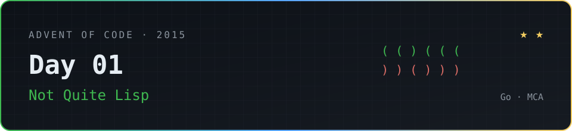
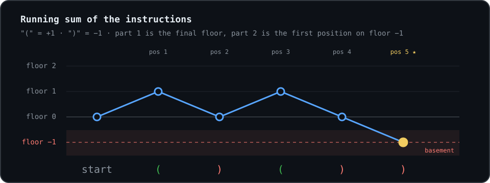

<div align="center">
  
</div>

> [!IMPORTANT]
> **The code was written 100% by a human.** Every line of the solutions in this repository was written by hand, without any kind of help from artificial intelligence: no generated code, no hints, no suggestions.
> AI was only used afterwards, to turn that finished, hand-written code into this README (the text and the diagrams).

## 🧩 The puzzle

Santa is in a huge apartment building and gets directions as a string of parentheses.
An opening parenthesis `(` means *go up one floor* and a closing one `)` means *go down one floor*.
He starts on floor `0`, and the building has no top or bottom.

| Part | Question |
| :--: | -------- |
| ⭐ 1 | On which floor does Santa end up after following all the instructions? |
| ⭐ 2 | What is the position (1-indexed) of the first character that takes him into the basement (floor `-1`)? |

## 💡 The idea

Both parts are the same **running sum**: map `(` to `+1` and `)` to `-1` and add them up as you walk the input.

- **Part 1** is simply the final value of the sum.
- **Part 2** is the index of the first step where the sum becomes `-1`. The Go version stops reading the input right there.

<div align="center">
  
</div>

## 🛠️ Implementations

| Language | Highlights |
| -------- | ---------- |
| [Go](./go) | Streams the input in 1 KB chunks through a `bufio.Reader` and hands each step (`+1`/`-1`) to a callback. The callback returns `true` to stop early, so part 2 stops reading at the first visit to the basement. |
| [MCA](./mca) | Written in the author's own language [MCA](https://github.com/marcos-venicius/MCA). One pass over the whole file solves both parts: it keeps the floor and records the position only the first time the floor is `-1`. Other characters (like the trailing `\n`) leave the floor unchanged. |

```go
// the core of the Go version: a tiny "visitor" over the instructions
iterator(func(n int) bool {
  index++
  ans += n
  return ans == -1 // stop as soon as we reach the basement
})
```

## ⏱️ Complexity

| | Time | Memory |
| - | :--: | :----: |
| Part 1 | `O(n)` | `O(1)` |
| Part 2 | `O(k)`, where `k` is the position of the first basement visit | `O(1)` |

## ▶️ Running

Each solution reads `input.txt` from the current directory.

```bash
cd go  && go run main.go    # Go
cd mca && mca main.mca      # MCA
```
