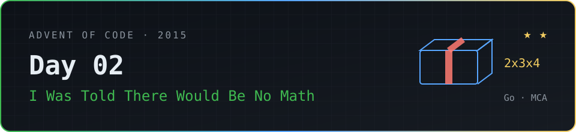
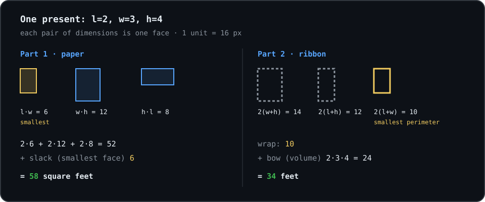

<div align="center">
  
</div>

> [!IMPORTANT]
> **The code was written 100% by a human.** Every line of the solutions in this repository was written by hand, without any kind of help from artificial intelligence: no generated code, no hints, no suggestions.
> AI was only used afterwards, to turn that finished, hand-written code into this README (the text and the diagrams).

## 🧩 The puzzle

The elves have a list of presents, one per line, each a perfect box written as `LxWxH` (for example `2x3x4`).
They need to know how much wrapping paper and how much ribbon to order.

| Part | Question |
| :--: | -------- |
| ⭐ 1 | Paper for each box is its surface area plus the area of its smallest face. How many square feet in total? |
| ⭐ 2 | Ribbon for each box is the smallest perimeter of any face plus the box volume (for the bow). How many feet in total? |

## 💡 The idea

There is no search here: each line is parsed into three numbers, a small formula is applied, and the results are summed.

- **Paper** = `2·lw + 2·wh + 2·hl` + the smallest of `lw`, `wh`, `hl`.
- **Ribbon** = the smallest of `2(w+h)`, `2(l+h)`, `2(l+w)` + `l·w·h`.

Instead of sorting the three dimensions, both versions just compute the three candidate values and take the `min`.

<div align="center">
  
</div>

## 🛠️ Implementations

| Language | Highlights |
| -------- | ---------- |
| [Go](./go) | A `dim` struct with two methods, `calcFeet` and `calcBowRibbon`. The minimum is taken with nested `math.Min` calls on `float64` values and converted back to `int`. `solve1` and `solve2` each read and parse the file again. |
| [MCA](./mca) | Written in the author's own language [MCA](https://github.com/marcos-venicius/MCA). Each line is split on `x`, mapped to ints and turned into a `{l, w, h}` map with `indexes_to_keys`. Both parts share one helper, `solve(fn)`, which is `sum(map(input, fn))`. |

```go
func (d *dim) calcFeet() int {
  x := int(math.Min(math.Min(float64(d.l * d.w), float64(d.l * d.h)), float64(d.w * d.h)))

  return 2*d.l*d.w + 2*d.w*d.h + 2*d.h*d.l + x
}
```

## ⏱️ Complexity

| | Time | Memory |
| - | :--: | :----: |
| Part 1 | `O(n)` | `O(n)` (the parsed list) |
| Part 2 | `O(n)` | `O(n)` |

## ▶️ Running

Each solution reads `input.txt` from the current directory.

```bash
cd go  && go run main.go    # Go
cd mca && mca main.mca      # MCA
```
