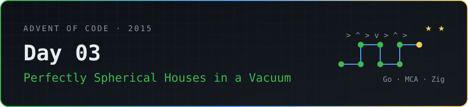
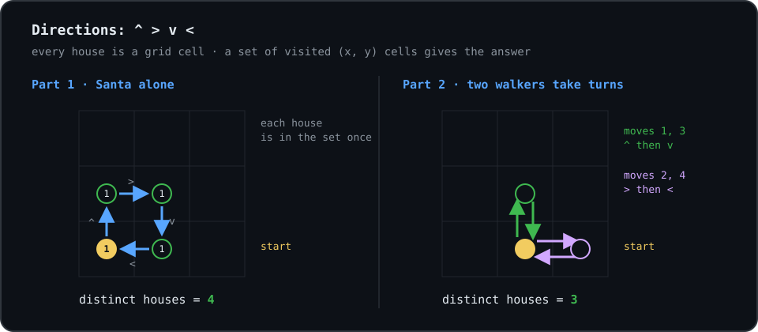

<div align="center">
  
</div>

> [!IMPORTANT]
> **The code was written 100% by a human.** Every line of the solutions in this repository was written by hand, without any kind of help from artificial intelligence: no generated code, no hints, no suggestions.
> AI was only used afterwards, to turn that finished, hand-written code into this README (the text and the diagrams).

## 🧩 The puzzle

Santa delivers presents on an infinite 2D grid of houses. The input is one long line of moves:
`^` north, `v` south, `>` east and `<` west. He delivers a present at the start house and at every house he moves to.

| Part | Question |
| :--: | -------- |
| ⭐ 1 | How many houses receive at least one present? |
| ⭐ 2 | Santa and Robo-Santa take turns reading the moves (one takes the 1st, 3rd, 5th... move, the other the 2nd, 4th, 6th...). How many houses receive at least one present now? |

## 💡 The idea

Keep the current `(x, y)` position and a **set of visited positions**. Each move changes one coordinate by one,
and the answer is the size of the set (or a counter that goes up only when a position is new).

For part 2 there are two positions instead of one. The parity of the move index (`i % 2`) chooses which walker moves,
and both walkers share the same set of visited houses.

<div align="center">
  v<: Santa alone visits 4 houses, two walkers taking turns visit 3" width="100%">
</div>

## 🛠️ Implementations

| Language | Highlights |
| -------- | ---------- |
| [Go](./go) | The visited set is a `map[string]struct{}` keyed by `"%dx%d"`. Part 1 records the house *before* applying each move. Part 2 uses a `movements` map from rune to `[2]int`, moves first and then records the new house. |
| [MCA](./mca) | Written in the author's own language [MCA](https://github.com/marcos-venicius/MCA). One loop solves both parts at once with two sets, `v1` and `v2`, using a `MOVES` table and string keys like `"3x-2"`. It records the house after each move, and adds `as_int(!contains(...))` to the counters. |
| [Zig](./zig) | Reads the file byte by byte through a buffered reader and stores a `Vector2` struct directly as the key of an `AutoHashMap`. Each byte first records the current house and then applies the move; the loop stops at the `\n`. In part 2 a pointer `curr` switches between `santa` and `elf` with `@mod(i, 2)`. |

```zig
curr = if (@mod(i, 2) == 0) &santa else &elf;

if (!board.contains(curr.*)) ans += 1;

try board.put(curr.*, true);
```

## ⏱️ Complexity

| | Time | Memory |
| - | :--: | :----: |
| Part 1 | `O(n)` | `O(h)`, where `h` is the number of distinct houses |
| Part 2 | `O(n)` | `O(h)` |

## ▶️ Running

Each solution reads `input.txt` from the current directory.

```bash
cd go  && go run .          # Go (main.go, one.go, two.go, utils.go)
cd mca && mca main.mca      # MCA
cd zig && zig run main.zig  # Zig
```
