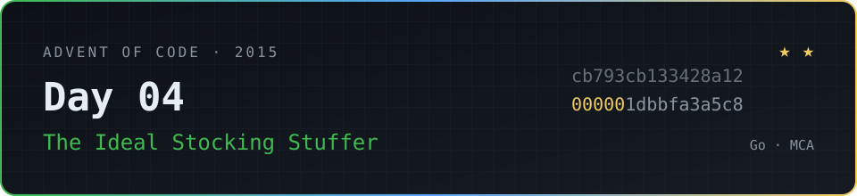
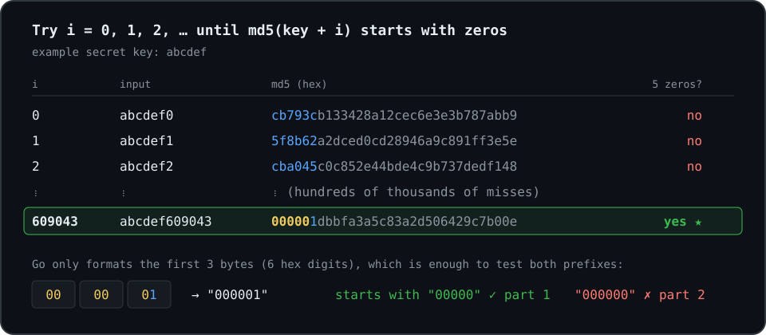

<div align="center">
  
</div>

> [!IMPORTANT]
> **The code was written 100% by a human.** Every line of the solutions in this repository was written by hand, without any kind of help from artificial intelligence: no generated code, no hints, no suggestions.
> AI was only used afterwards, to turn that finished, hand-written code into this README (the text and the diagrams).

## 🧩 The puzzle

Santa is mining AdventCoins. The input is a short secret key. Append a positive decimal number to the key,
hash it with **MD5**, and look at the hexadecimal digest.

| Part | Question |
| :--: | -------- |
| ⭐ 1 | What is the lowest number that makes the hash start with five zeros (`00000`)? |
| ⭐ 2 | What is the lowest number that makes the hash start with six zeros (`000000`)? |

## 💡 The idea

There is no shortcut for MD5, so this is a plain **brute-force search**: try `0, 1, 2, …`, hash `key + number`,
and stop at the first hash with the required prefix.

Each extra zero makes a hit about 16 times rarer, so part 2 takes far more attempts than part 1.

<div align="center">
  
</div>

## 🛠️ Implementations

| Language | Highlights |
| -------- | ---------- |
| [Go](./go) | Uses `crypto/md5` and a shared `hash(input, n)` helper. Instead of formatting the whole 16-byte digest, `startsWith5`/`startsWith6` format only `h[:3]` (6 hex digits) and check the prefix. Parts 1 and 2 are two independent loops that both start at `0`. |
| [MCA](./mca) | Written in the author's own language [MCA](https://github.com/marcos-venicius/MCA). One `while` loop looks for both answers at the same time using the built-in `crypt.md5`. The checks are an `if`/`elif` pair: the `if` fills the five-zero answer and the `elif` fills the six-zero one, and the loop runs until both are set. |

```go
func startsWith5(h [16]byte) bool {
  return strings.HasPrefix(fmt.Sprintf("%x", h[:3]), "00000")
}
```

## ⏱️ Complexity

| | Time | Memory |
| - | :--: | :----: |
| Part 1 | `O(k)` hashes, where `k` is the answer (about 16⁵ tries expected) | `O(1)` |
| Part 2 | `O(k)` hashes (about 16⁶ tries expected) | `O(1)` |

## ▶️ Running

Each solution reads the secret key from `input.txt` in the current directory.

```bash
cd go  && go run .          # Go (main.go, one.go, two.go, utils.go)
cd mca && mca main.mca      # MCA
```
