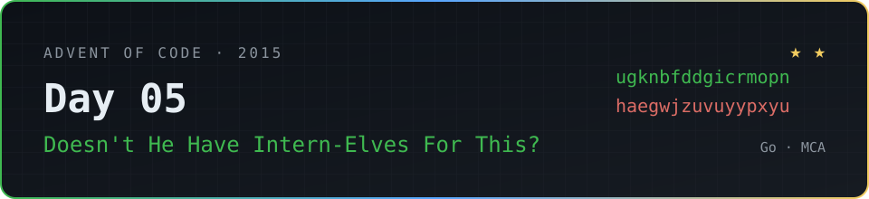
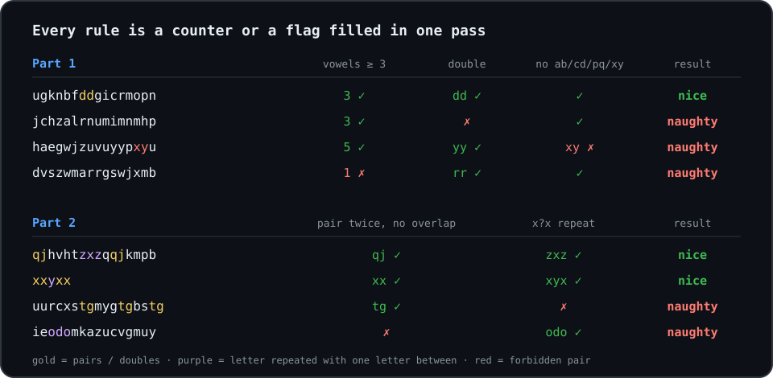
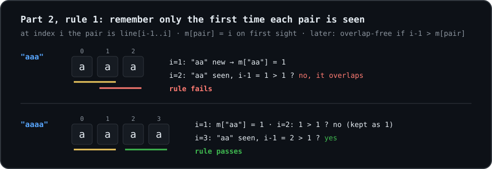

<div align="center">
  
</div>

> [!IMPORTANT]
> **The code was written 100% by a human.** Every line of the solutions in this repository was written by hand, without any kind of help from artificial intelligence: no generated code, no hints, no suggestions.
> AI was only used afterwards, to turn that finished, hand-written code into this README (the text and the diagrams).

## 🧩 The puzzle

Santa has a text file full of strings and needs to know which ones are *nice* and which ones are *naughty*.
The answer to both parts is simply how many strings are nice, but the rules change.

| Part | Question |
| :--: | -------- |
| ⭐ 1 | Nice = at least three vowels, at least one letter that appears twice in a row, and none of `ab`, `cd`, `pq`, `xy`. How many strings are nice? |
| ⭐ 2 | Nice = a pair of letters that appears twice without overlapping (`xyxy` yes, `aaa` no), and a letter that repeats with exactly one letter between (`xyx`, `aaa`). How many strings are nice? |

## 💡 The idea

Each string is checked in a **single left-to-right pass**, looking at the current character and its neighbours:

- **Part 1** keeps three counters: vowels, doubled letters (`s[i] == s[i-1]`) and forbidden pairs (`s[i-1..i]`).
- **Part 2** keeps two flags. The "one letter between" rule is `s[i-1] == s[i+1]`. The repeated pair rule uses a map
  from each pair to the index where it was **first** seen; a later copy counts only if it starts after that index,
  which rules out overlaps like `aaa`.

<div align="center">
  
</div>

<div align="center">
  
</div>

## 🛠️ Implementations

| Language | Highlights |
| -------- | ---------- |
| [Go](./go) | `isNice` and `isNiceTwo` follow the idea above, with helpers `isVowel` and `isIlegal` in `utils.go`. Includes `go test` tests with the puzzle examples plus extra strings such as `aaaa` (nice) and `aaa` (naughty) for part 2. The comments in `two.go` explain why only the first index of each pair is stored. |
| [MCA](./mca) | Written in the author's own language [MCA](https://github.com/marcos-venicius/MCA). Uses set literals for the vowels and the forbidden pairs, and adds booleans with `as_int(...)` to build the counters. The part 2 loop stops early as soon as both flags are `true`. Both parts share `solve(fn)`. |

```go
// get a pair, for example "aa"
p := string(line[i-1 : i+1])

if v, ok := m[p]; ok {
  if i-1 > v {
    firstRule = true
  }
} else {
  m[p] = i
}
```

## ⏱️ Complexity

| | Time | Memory |
| - | :--: | :----: |
| Part 1 | `O(total length)` | `O(1)` per string |
| Part 2 | `O(total length)` | `O(L)` per string for the pair map, `L` = string length |

## ▶️ Running

Each solution reads `input.txt` from the current directory.

```bash
cd go  && go run .          # Go
cd go  && go test           # Go tests with the puzzle examples
cd mca && mca main.mca      # MCA
```
