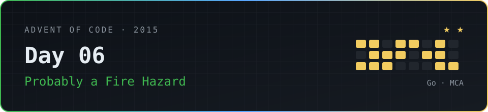
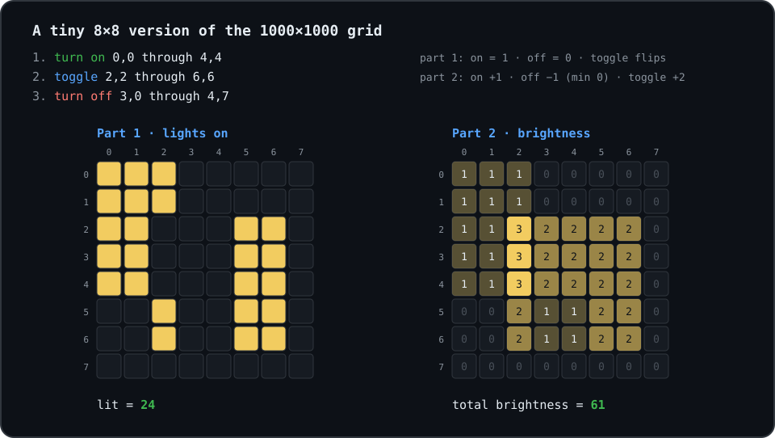

<div align="center">
  
</div>

> [!IMPORTANT]
> **The code was written 100% by a human.** Every line of the solutions in this repository was written by hand, without any kind of help from artificial intelligence: no generated code, no hints, no suggestions.
> AI was only used afterwards, to turn that finished, hand-written code into this README (the text and the diagrams).

## 🧩 The puzzle

There is a 1000×1000 grid of lights, all off at the start. Each line of the input is an instruction over a rectangle
given by two inclusive corners, for example `toggle 2,2 through 6,6`. The actions are `turn on`, `turn off` and `toggle`.

| Part | Question |
| :--: | -------- |
| ⭐ 1 | Lights are on/off: `turn on` sets 1, `turn off` sets 0, `toggle` flips. How many lights are lit at the end? |
| ⭐ 2 | Lights have a brightness: `turn on` adds 1, `turn off` subtracts 1 (never below 0), `toggle` adds 2. What is the total brightness? |

## 💡 The idea

The grid is small enough (one million cells) to **simulate directly**: keep a 1000×1000 matrix of ints,
and for every instruction loop over every cell of its rectangle.

Instead of summing the whole matrix at the end, both versions keep a **running total** that is updated
cell by cell: in part 1 it goes up when a light turns on and down when it turns off, in part 2 it follows
every brightness change.

<div align="center">
  
</div>

## 🛠️ Implementations

| Language | Highlights |
| -------- | ---------- |
| [Go](./go) | `parseLine` turns a line into a `Line{action, from, to}` (the `toggle` line has one word less, so the start corner is at a different index). Part 1 flips with `m[r][c] ^= 1`. Lines are streamed through the author's [`aocreader`](https://github.com/marcos-venicius/aocreader) package, which also offers a mock reader that the `go test` tests use. |
| [MCA](./mca) | Written in the author's own language [MCA](https://github.com/marcos-venicius/MCA). The parser lives in `parser.mca` and exports the action constants. `main.mca` builds two 1000×1000 matrices (`m1`, `m2`) and solves **both parts in the same loop**, also printing how long it took. |

```go
case toggleLight:
  m[r][c] ^= 1
  if curr == 0 {
    litLights++
  } else {
    litLights--
  }
```

## ⏱️ Complexity

| | Time | Memory |
| - | :--: | :----: |
| Part 1 | `O(Σ rectangle areas)`, up to `n · 10⁶` | `O(10⁶)` |
| Part 2 | `O(Σ rectangle areas)` | `O(10⁶)` |

## ▶️ Running

Each solution reads `input.txt` from the current directory.

```bash
cd go  && go run .          # Go
cd go  && go test           # Go tests (some of them also read input.txt)
cd mca && mca main.mca      # MCA
```
