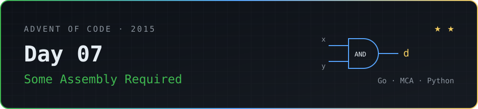
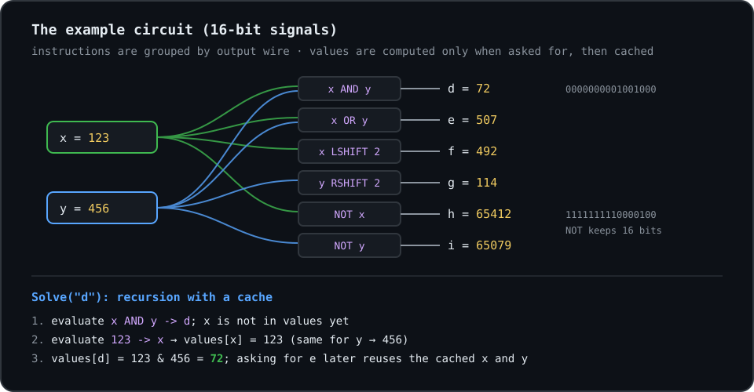

<div align="center">
  
</div>

> [!IMPORTANT]
> **The code was written 100% by a human.** Every line of the solutions in this repository was written by hand, without any kind of help from artificial intelligence: no generated code, no hints, no suggestions.
> AI was only used afterwards, to turn that finished, hand-written code into this README (the text and the diagrams).

## 🧩 The puzzle

Little Bobby Tables got a kit of wires and bitwise logic gates. Each line connects a signal to one wire,
for example `123 -> x`, `x AND y -> d`, `x LSHIFT 2 -> f` or `NOT y -> i`. Signals are 16-bit numbers,
the gates are `AND`, `OR`, `LSHIFT`, `RSHIFT` and `NOT`, and the lines are **not** in dependency order.

| Part | Question |
| :--: | -------- |
| ⭐ 1 | What signal ends up on wire `a`? |
| ⭐ 2 | Take the part 1 signal of `a`, force it onto wire `b`, reset every other wire and evaluate again. What is the new signal on `a`? |

## 💡 The idea

Treat the circuit as a dependency graph and **evaluate on demand with memoisation**:

1. Parse every line into an instruction (kind, inputs, output) and group the instructions by their **output wire**.
2. To get a wire, run the instruction that writes it. If one of its inputs has no value yet, recursively run the
   instruction(s) for that input first. Every computed value goes into a `values` map, so each wire is computed once.
3. For part 2, keep `a`'s value, clear the map, put that value into `b`, and ask for `a` again. Because `b` is already
   in the map, its own instruction is never run.

<div align="center">
  
</div>

## 🛠️ Implementations

All three versions share the same structure: an `Instruction` with a *kind* (assign a value, assign a wire, `AND`, `OR`, `NOT`, `LSHIFT`, `RSHIFT`), and a solver holding `values` and `instructions` grouped by output.

| Language | Highlights |
| -------- | ---------- |
| [Go](./go) | `lib.go` has the parser and a recursive `Evaluate`. Values are `uint16`, and `NOT` is `^v`. For `AND`/`OR`, an operand that is not a known wire is parsed as a number (lines like `1 AND x`). Lines come from the author's [`aocreader`](https://github.com/marcos-venicius/aocreader) package. |
| [MCA](./mca) | Written in the author's own language [MCA](https://github.com/marcos-venicius/MCA). Split into `parser.mca`, `evaluator.mca` and `lib.mca`. The evaluator uses a **dispatch table** (`cases`) from instruction kind to handler function; `AND`/`OR` fall through to the generic code at the end. |
| [Python](./python) | Two scripts: `one.py` solves part 1 and `two.py` solves part 2 (its `solve` runs the circuit twice). `NOT` is computed as `~v & 0xFFFF`. `Instruction.__str__` prints a line as readable code such as `d = x & y`. |

```go
case NOT_KIND:
  if _, ok := s.values[instruction.left]; !ok {
    for _, missingInstruction := range s.instructions[instruction.left] {
      s.Evaluate(missingInstruction)
    }
  }

  varValue := s.values[instruction.left]

  s.values[instruction.output] = ^varValue
```

## ⏱️ Complexity

| | Time | Memory |
| - | :--: | :----: |
| Part 1 | `O(n)`, each wire is computed once thanks to the cache | `O(n)`, plus recursion depth up to the longest dependency chain |
| Part 2 | `O(n)` | `O(n)` |

## ▶️ Running

Each solution reads `input.txt` from the current directory.

```bash
cd go     && go run .           # Go
cd go     && go test            # Go tests (they read input.txt)
cd mca    && mca main.mca       # MCA
cd python && python3 one.py     # Python, part 1
cd python && python3 two.py     # Python, part 2
```
