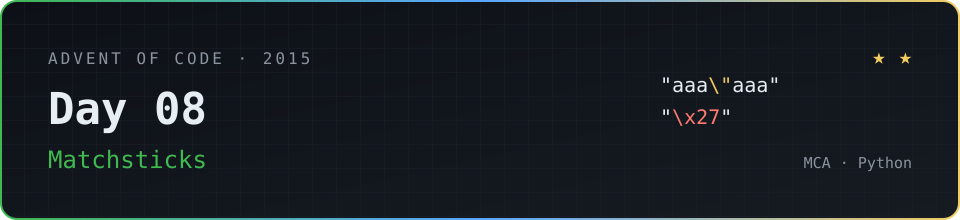
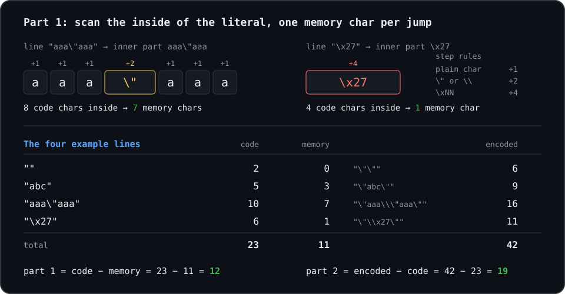

<div align="center">
  
</div>

> [!IMPORTANT]
> **The code was written 100% by a human.** Every line of the solutions in this repository was written by hand, without any kind of help from artificial intelligence: no generated code, no hints, no suggestions.
> AI was only used afterwards, to turn that finished, hand-written code into this README (the text and the diagrams).

## 🧩 The puzzle

Santa's list is a file of double-quoted string literals, one per line, that may contain escape sequences:
`\\` (a backslash), `\"` (a quote) and `\x` followed by two hex digits (one character).

| Part | Question |
| :--: | -------- |
| ⭐ 1 | What is the number of characters of code (as written in the file) minus the number of characters in memory (after decoding)? |
| ⭐ 2 | Encode every line again as a new string literal (escaping `"` and `\`, and adding outer quotes). What is the encoded length minus the original code length? |

## 💡 The idea

Neither part builds the decoded or encoded strings; the code only counts **lengths**.

- **Part 1**: the code length is just `len(line)`. For the memory length, drop the outer quotes and walk the rest
  with an index: a plain character moves 1 step, `\"` or `\\` moves 2 steps, `\xNN` moves 4 steps, and each
  step counts as one character in memory.
- **Part 2**: every `"` or `\` becomes two characters, anything else stays one, and each line gets 2 new outer quotes.

<div align="center">
  
</div>

## 🛠️ Implementations

| Language | Highlights |
| -------- | ---------- |
| [MCA](./mca) | Written in the author's own language [MCA](https://github.com/marcos-venicius/MCA). One loop computes all three counts. `scape(line, i)` returns two values, the memory characters (always `1`) and the next index. The 2 extra quotes of part 2 are added once at the end as `len(lines) * 2`. |
| [Python](./python) | Two scripts: `one.py` for part 1 and `two.py` for part 2, each with a small `Parser` and `Solve` class. `one.py` uses the same `scape` helper returning `(count, next_index)`, and `two.py` uses `encode(char)` returning 2 for `"` and `\`. |

```python
def scape(self, line: str, i: int) -> tuple[int, int]:
    if line[i] != '\\':
        return 1, i + 1

    if line[i + 1] == 'x':
        return 1, i + 4
    elif line[i + 1] == '"' or line[i + 1] == '\\':
        return 1, i + 2
```

## ⏱️ Complexity

| | Time | Memory |
| - | :--: | :----: |
| Part 1 | `O(total length)` | `O(1)` besides the lines |
| Part 2 | `O(total length)` | `O(1)` besides the lines |

## ▶️ Running

Each solution reads `input.txt` from the current directory.

```bash
cd mca    && mca main.mca       # MCA, both parts
cd python && python3 one.py     # Python, part 1
cd python && python3 two.py     # Python, part 2
```
