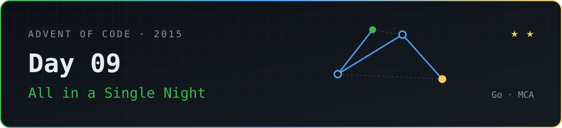
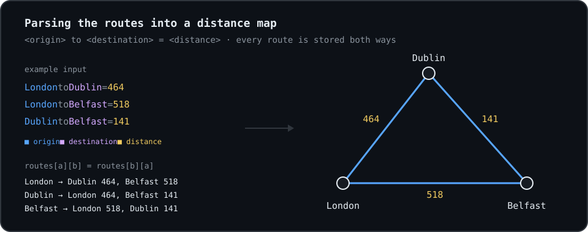
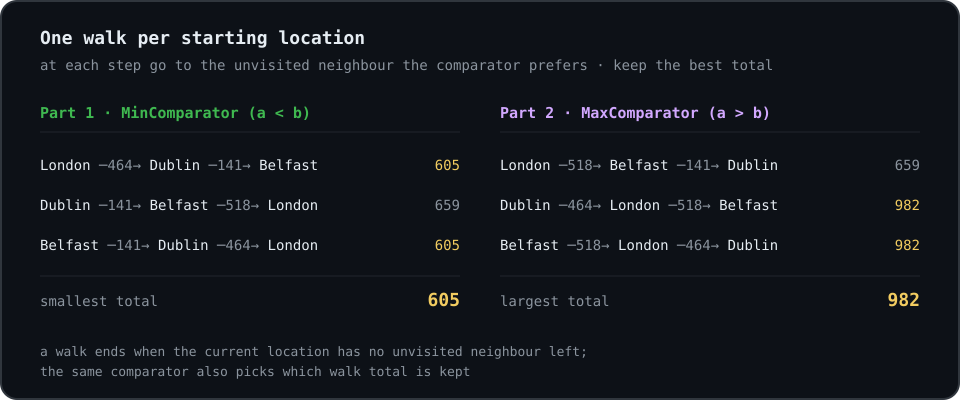

<div align="center">
  
</div>

> [!IMPORTANT]
> **The code was written 100% by a human.** Every line of the solutions in this repository was written by hand, without any kind of help from artificial intelligence: no generated code, no hints, no suggestions.
> AI was only used afterwards, to turn that finished, hand-written code into this README (the text and the diagrams).

## 🧩 The puzzle

Santa has to deliver presents to a set of locations, and the input lists the distance between every pair of them, one line each, like `London to Dublin = 464`.
He may start and finish anywhere, but must visit every location exactly once.

| Part | Question |
| :--: | -------- |
| ⭐ 1 | What is the distance of the shortest route that visits every location? |
| ⭐ 2 | What is the distance of the longest route that visits every location? |

## 💡 The idea

Both parts share the same code. The only thing that changes is a **comparator**: `a < b` for part 1 and `a > b` for part 2.

First, every line becomes a route (origin, destination, distance). The Go version matches each line against a regular expression, so extra spaces around `to` and `=` are accepted; the MCA version splits the line on single spaces. Every route is saved **in both directions** in a map of maps (`routes[origin][destination]`), and every name is added to a set of locations.

<div align="center">
  
</div>

Then, for **every location as a starting point**, `nextDistance` / `next_distance` walks the map: it marks the current location as visited, looks at its unvisited neighbours, moves to the one whose distance the comparator prefers, and adds that distance to the total. The walk ends when no unvisited neighbour is left. Finally `Distance` / `distance` keeps the walk total that the same comparator prefers.

<div align="center">
  
</div>

On the puzzle's example the tests expect `605` for part 1 and `982` for part 2.

## 🛠️ Implementations

| Language | Highlights |
| -------- | ---------- |
| [Go](./go) | A `Database` struct holds the routes, the locations, the `Comparator` and the compiled route pattern. `solveOne` and `solveTwo` each build their own database (with `MinComparator` / `MaxComparator`) from the lines given by the author's [`aocreader`](https://github.com/marcos-venicius/aocreader) package. Comes with tests for the parser, the database and both parts on the example. |
| [MCA](./mca) | Written in the author's own language [MCA](https://github.com/marcos-venicius/MCA). Split into `parser.mca` (destructures `origin, _, destination, _, distance` from a space split), `lib.mca` (the database and the walk) and `main.mca`, which builds two databases with lambda comparators and fills both in a single loop. |

```go
// the route "syntax" used by the Go parser
routePattern := regexp.MustCompile(`^(\s?)*([A-z]+)\s+to\s+([A-z]+)(\s?)*=(\s?)*([0-9]+)$`)
```

```go
// one step of the walk: pick the unvisited neighbour the comparator prefers
for key, distance := range d.routes[origin] {
  if _, ok := visited[key]; ok {
    continue
  }

  if routeDistance == -1 || d.comparator(distance, routeDistance) {
    routeDistance = distance
    route = key
  }
}
```

## ⏱️ Complexity

For `n` locations and `r` input lines:

| | Time | Memory |
| - | :--: | :----: |
| Parsing | `O(r)` | `O(n²)` for the two-way distance map |
| Part 1 / Part 2 | `O(n³)`: `n` walks of `n` steps, each scanning up to `n` neighbours | `O(n)` per walk (visited set and recursion) |

## ▶️ Running

Both solutions read `input.txt` from the current directory.

```bash
cd go  && go run .      # Go, both parts
cd go  && go test       # Go, tests on the example
cd mca && mca main.mca  # MCA, both parts
```
