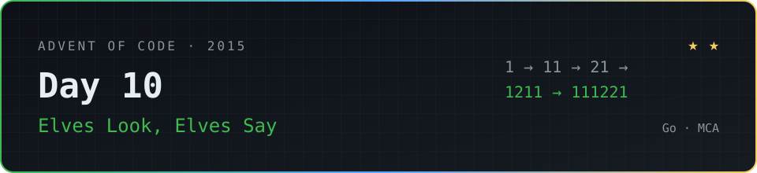
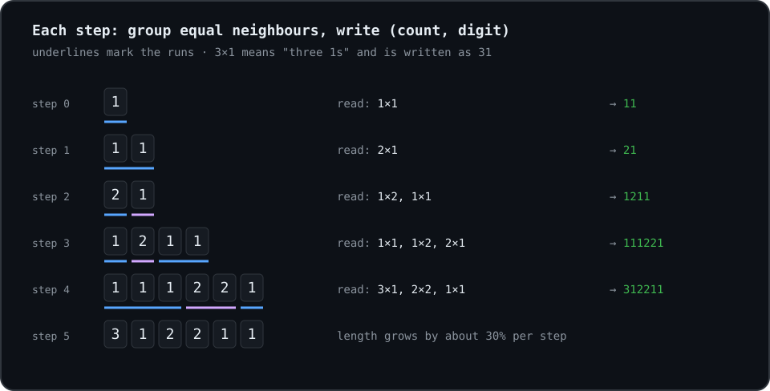

<div align="center">
  
</div>

> [!IMPORTANT]
> **The code was written 100% by a human.** Every line of the solutions in this repository was written by hand, without any kind of help from artificial intelligence: no generated code, no hints, no suggestions.
> AI was only used afterwards, to turn that finished, hand-written code into this README (the text and the diagrams).

## 🧩 The puzzle

The elves play **look-and-say**: read a sequence of digits aloud, group by runs of equal digits, and write
each run as its length followed by the digit. `1` becomes `11` (one 1), which becomes `21` (two 1s), then `1211`, `111221`, and so on.
The input is the starting sequence.

| Part | Question |
| :--: | -------- |
| ⭐ 1 | Apply the process 40 times. What is the length of the result? |
| ⭐ 2 | Apply it 50 times. What is the length of the result? |

## 💡 The idea

This is a **direct simulation**, a run-length encoding applied over and over:

1. Walk the current sequence with an index `i`; remember the digit `c` and count how many times it repeats (`s`).
2. Append `s` and then `c` to the next sequence.
3. Repeat for the given number of rounds and return the length.

The sequence grows by roughly 30% each round, so after 50 rounds it has millions of digits. Both versions keep the
digits as a **list of ints**.

<div align="center">
  
</div>

## 🛠️ Implementations

| Language | Highlights |
| -------- | ---------- |
| [Go](./go) | `prepare` does the first round straight from the input string into a `[]int`; `solve(line, until)` then runs the remaining `until - 1` rounds on int slices. Parts 1 and 2 each start again from the input (40 and 50 rounds). Lines come from the author's [`aocreader`](https://github.com/marcos-venicius/aocreader) package, and `go test` checks both parts against `input.txt`. |
| [MCA](./mca) | Written in the author's own language [MCA](https://github.com/marcos-venicius/MCA). Same `prepare` + `solve` structure, but `solve` also returns the final sequence, so part 2 **continues from the part 1 result** and runs only 10 more rounds (`solve(result, 11)`). |

```go
for i < len(data) {
  s := 1
  c := data[i]

  i += 1

  for i < len(data) && data[i] == c {
    i += 1
    s += 1
  }

  result = append(result, s)
  result = append(result, c)
  ...
}
```

## ⏱️ Complexity

With `L₀` the input length and growth factor λ ≈ 1.30 per round:

| | Time | Memory |
| - | :--: | :----: |
| Part 1 | `O(L₀ · λ⁴⁰)` (sum of all round lengths) | `O(L₀ · λ⁴⁰)` |
| Part 2 | `O(L₀ · λ⁵⁰)` | `O(L₀ · λ⁵⁰)` |

## ▶️ Running

Each solution reads `input.txt` from the current directory.

```bash
cd go  && go run .          # Go
cd go  && go test           # Go tests (they read input.txt)
cd mca && mca main.mca      # MCA
```
