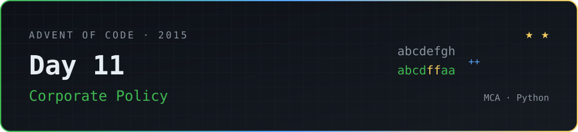
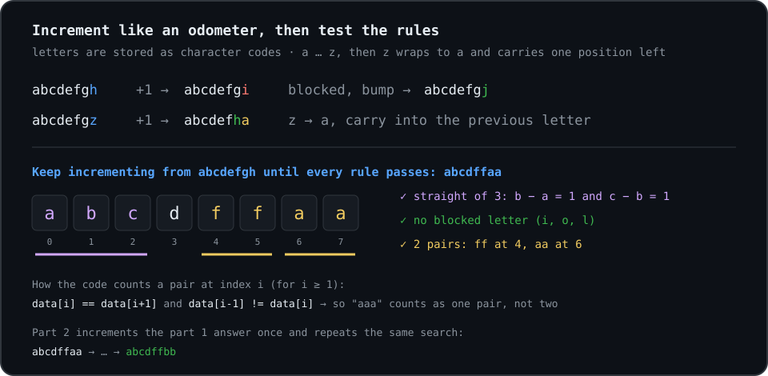

<div align="center">
  
</div>

> [!IMPORTANT]
> **The code was written 100% by a human.** Every line of the solutions in this repository was written by hand, without any kind of help from artificial intelligence: no generated code, no hints, no suggestions.
> AI was only used afterwards, to turn that finished, hand-written code into this README (the text and the diagrams).

## 🧩 The puzzle

Santa's password expired. The new password is found by **incrementing** the old one like a number written with
the letters `a`–`z` (`xx`, `xy`, `xz`, `ya`, …) until it satisfies the security rules:

- it contains an increasing straight of three letters, like `abc` or `xyz`;
- it does not contain `i`, `o` or `l`;
- it contains at least two different, non-overlapping pairs of letters, like `aa` and `zz`.

| Part | Question |
| :--: | -------- |
| ⭐ 1 | What is the next valid password after the input? |
| ⭐ 2 | What is the next valid password after that one? |

## 💡 The idea

A **generate-and-test** loop:

1. Store the password as a list of character codes.
2. `increment_password(pos)` adds one to the last letter. If it was `z`, it becomes `a` and the call recurses into the
   previous position (the carry). After that, if any letter is `i`, `o` or `l`, that letter is incremented once more.
3. `is_valid_password` checks all rules in one pass: a straight is three codes that go up by exactly 1, and a pair is
   counted at index `i` when `data[i] == data[i+1]` and the letter before it is different.
4. Repeat until valid. For part 2, increment the part 1 answer once and run the same loop again.

<div align="center">
  
</div>

## 🛠️ Implementations

The two versions are line-by-line ports of each other.

| Language | Highlights |
| -------- | ---------- |
| [MCA](./mca) | Written in the author's own language [MCA](https://github.com/marcos-venicius/MCA). Uses `string.ord`/`string.chr` to move between letters and codes, and a small `run_part(p)` helper that loops until valid and prints the result. Reads `input.txt`. |
| [Python](./python) | Same functions and names (`increment_password`, `is_valid_password`, `print_password`). It reads the password from `./test.txt`. |

```python
def increment_password(pos):
  if data[pos] == max_c:
    data[pos] = min_c
    for i in range(pos, len(data)):
      data[i] = min_c
    increment_password(pos - 1)
  else:
    data[pos] = data[pos] + 1

  for i in range(len(data)):
    if data[i] in blocked:
      increment_password(i)
      break
```

## ⏱️ Complexity

| | Time | Memory |
| - | :--: | :----: |
| Part 1 | `O(k · L)`, where `k` is the number of candidates tried and `L` = 8 letters | `O(L)` |
| Part 2 | `O(k · L)` | `O(L)` |

## ▶️ Running

```bash
cd mca    && mca main.mca       # MCA, reads input.txt
cd python && python3 main.py    # Python, reads test.txt
```
