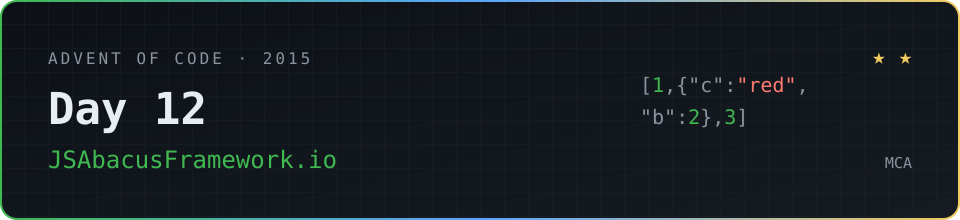
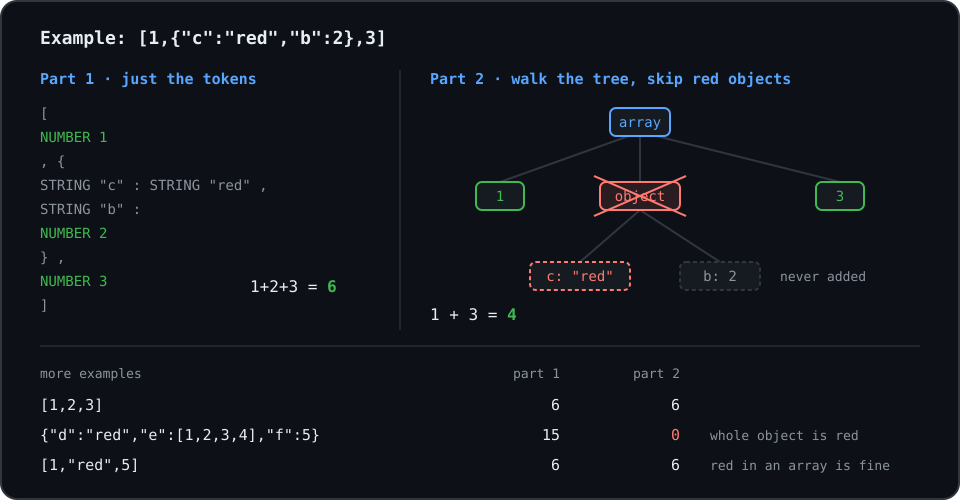

<div align="center">
  
</div>

> [!IMPORTANT]
> **The code was written 100% by a human.** Every line of the solutions in this repository was written by hand, without any kind of help from artificial intelligence: no generated code, no hints, no suggestions.
> AI was only used afterwards, to turn that finished, hand-written code into this README (the text and the diagrams).

## 🧩 The puzzle

Santa's accounting elves keep their books as one big **JSON document** made of arrays, objects, numbers and strings.

| Part | Question |
| :--: | -------- |
| ⭐ 1 | What is the sum of all numbers in the document? |
| ⭐ 2 | Ignore every object (and everything inside it) that has any property with the value `"red"`. What is the sum now? |

## 💡 The idea

- **Part 1** works on the tokens only: every number is a `NUMBER` token, so the solution runs the
  **lexer** and adds up the values of those tokens.
- **Part 2** works on the structure: the document is **parsed** into maps and arrays and walked recursively:
  a number adds its value, an array adds the sum of its items, and an object adds the sum of its values, unless
  one of its values is `"red"`, in which case the whole object counts as `0`. A `"red"` inside an array changes nothing.

<div align="center">
  
</div>

## 🛠️ Implementations

| Language | Highlights |
| -------- | ---------- |
| [MCA](./mca) | Written in the author's own language [MCA](https://github.com/marcos-venicius/MCA). `json.mca` is a copy of the author's own JSON library for MCA ([mca-json-parser](https://github.com/marcos-venicius/mca-json-parser)), with a hand-written lexer and recursive-descent parser. Besides `loads` and `dumps`, it exports `spit`, which runs the lexer and returns the token list; part 1 uses it. Part 2 is the recursive `iterator` in `main.mca`, which checks the value type with `is_typeof`. |

```r
const iterator = \(root, total = 0) -> {
  if !root return total

  delta = 0

  if is_typeof(root, 'map') {
    for _, v : root {
      if v == 'red' return total

      delta += iterator(v)
    }

    return total + delta
  }

  if is_typeof(root, 'int')   return total + root
  if is_typeof(root, 'array') for _, v : root delta += iterator(v)

  return total + delta
}
```

## ⏱️ Complexity

| | Time | Memory |
| - | :--: | :----: |
| Part 1 | `O(n)` over the characters | `O(t)` for the `t` tokens |
| Part 2 | `O(n)` to parse and walk | `O(n)` for the tree, plus recursion depth equal to the nesting depth |

## ▶️ Running

The solution reads `input.txt` from the current directory.

```bash
cd mca && mca main.mca      # MCA
```
