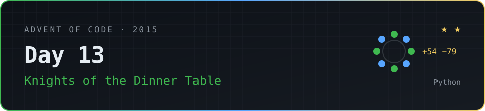
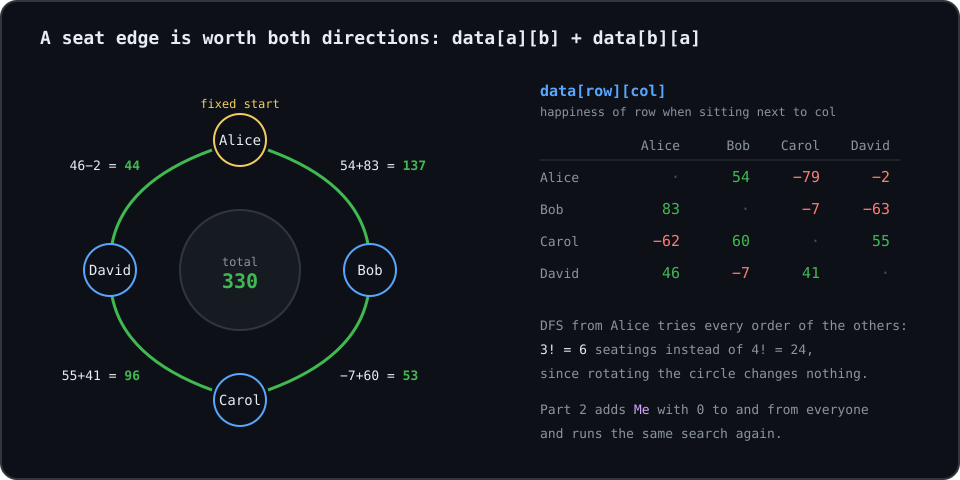

<div align="center">
  
</div>

> [!IMPORTANT]
> **The code was written 100% by a human.** Every line of the solutions in this repository was written by hand, without any kind of help from artificial intelligence: no generated code, no hints, no suggestions.
> AI was only used afterwards, to turn that finished, hand-written code into this README (the text and the diagrams).

## 🧩 The puzzle

The family dinner is around one **circular table**. For every pair of guests the input says how much happiness a
guest gains or loses when sitting next to the other, for example
`Alice would gain 54 happiness units by sitting next to Bob.` The feeling is not symmetric.

| Part | Question |
| :--: | -------- |
| ⭐ 1 | What is the total change in happiness for the best seating arrangement? |
| ⭐ 2 | You join the table, and you are neutral (0) with everyone. What is the best total now? |

## 💡 The idea

The guest list is small, so the solution tries **every seating** with a depth-first search:

1. Parse the lines into a nested dict `data[a][b]` (gain is positive, lose is negative).
2. Fix the first guest as the start (rotations of a circle are the same arrangement), then recursively add every guest
   not yet seated. Each new neighbour pair adds `data[a][b] + data[b][a]`.
3. When everyone is seated, close the circle by adding the pair between the last and the first guest, and keep the maximum.
4. For part 2, add a `Me` guest with `0` in both directions to and from everyone, and run the same search.

This is the travelling-salesman idea on a tiny graph: with `n` guests it looks at `(n-1)!` orders.

<div align="center">
  
</div>

## 🛠️ Implementations

| Language | Highlights |
| -------- | ---------- |
| [Python](./python) | A single file. The parser just picks words by position: name `chunks[0]`, `gain`/`lose` `chunks[2]`, amount `chunks[3]`, and the neighbour from the last word without its final `.`. `get_table(curr, amount)` is the recursive search, carrying the seated list and the running total. |

```python
def get_table(curr=[], amount=0):
    if len(curr) == len(data):
        return amount + data[curr[0]][curr[-1]] + data[curr[-1]][curr[0]]

    best = None

    for key in data[curr[-1]]:
        if key in curr:
            continue

        r = get_table(curr + [key], amount + data[curr[-1]][key] + data[key][curr[-1]])

        if best is None or r > best:
            best = r

    return best
```

## ⏱️ Complexity

| | Time | Memory |
| - | :--: | :----: |
| Part 1 | `O((n-1)! · n)` | `O(n²)` for the table, `O(n)` recursion |
| Part 2 | `O(n! · n)` (one more guest) | `O(n²)` |

## ▶️ Running

The script reads `input.txt` from the current directory.

```bash
cd python && python3 main.py
```
