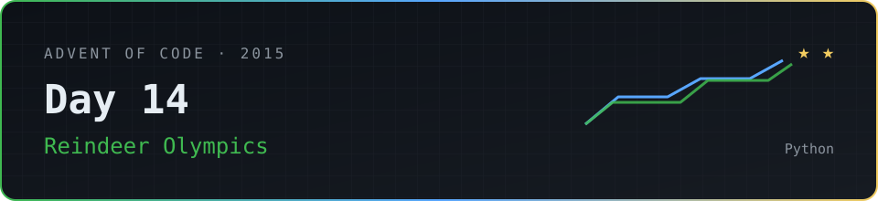
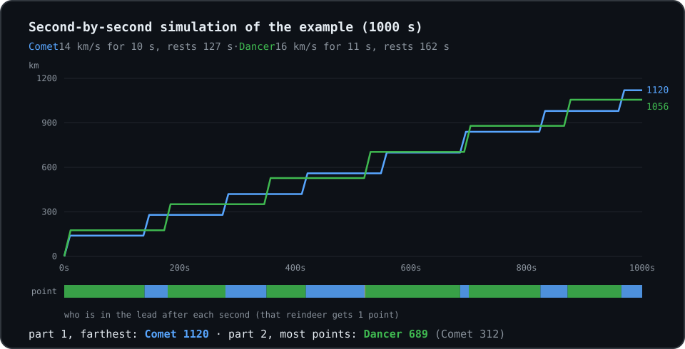

<div align="center">
  
</div>

> [!IMPORTANT]
> **The code was written 100% by a human.** Every line of the solutions in this repository was written by hand, without any kind of help from artificial intelligence: no generated code, no hints, no suggestions.
> AI was only used afterwards, to turn that finished, hand-written code into this README (the text and the diagrams).

## 🧩 The puzzle

Each reindeer can fly at a fixed speed for a fixed number of seconds, and then must rest for a fixed number of seconds,
repeating this cycle forever. For example: `Comet can fly 14 km/s for 10 seconds, but then must rest for 127 seconds.`
The race lasts **2503 seconds**.

| Part | Question |
| :--: | -------- |
| ⭐ 1 | After 2503 seconds, how far has the winning reindeer travelled? |
| ⭐ 2 | New scoring: at the end of each second, every reindeer currently in the lead gets one point (ties all score). How many points does the winner have? |

## 💡 The idea

A **second-by-second simulation**. Each reindeer is a small state machine with two modes:

- **running**: add the speed to the distance, until it has flown for `duration` seconds, then switch to resting;
- **resting**: wait until `rest` seconds have passed, then switch back to running.

Every second, all reindeer take one step, the ones with the largest distance so far are collected as `winners`,
and each of them gets a point. At the end, part 1 is the largest distance and part 2 the largest score.

<div align="center">
  
</div>

## 🛠️ Implementations

| Language | Highlights |
| -------- | ---------- |
| [Python](./python) | A `Reindeer` class with a `mode` (`running` / `resting`), the counters `running_for` and `resting_for`, and a `run()` method that advances one second. The parser takes the numbers by word position (`chunks[3]`, `chunks[6]`, `chunks[13]`). The race length is the constant `seconds = 2503`. |

```python
for s in range(seconds):
    winners = []

    for reindeer in reindeers:
        reindeer.run()

        if len(winners) == 0 or reindeer.traveled == winners[0].traveled:
            winners.append(reindeer)
        elif reindeer.traveled > winners[0].traveled:
            winners = [reindeer]

    for winner in winners:
        winner.give_point()
```

## ⏱️ Complexity

With `r` reindeer and `T = 2503` seconds:

| | Time | Memory |
| - | :--: | :----: |
| Part 1 | `O(r · T)` | `O(r)` |
| Part 2 | `O(r · T)` (same simulation) | `O(r)` |

## ▶️ Running

The script opens `../input.txt`, so the input file goes in the day folder (next to `python/`), and the script is run from inside `python/`.

```bash
cd python && python3 main.py
```
