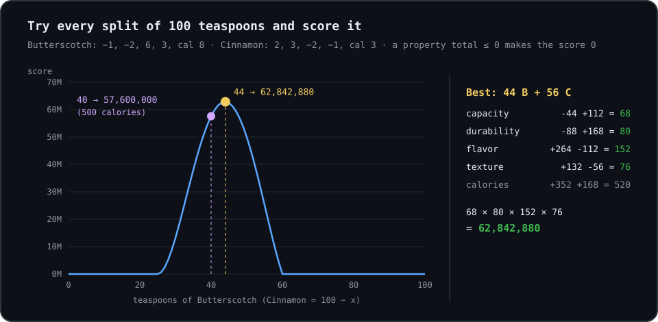

<div align="center">
  
</div>

> [!IMPORTANT]
> **The code was written 100% by a human.** Every line of the solutions in this repository was written by hand, without any kind of help from artificial intelligence: no generated code, no hints, no suggestions.
> AI was only used afterwards, to turn that finished, hand-written code into this README (the text and the diagrams).

## 🧩 The puzzle

A cookie recipe needs exactly **100 teaspoons** of ingredients. Each ingredient has five properties per teaspoon:
`capacity`, `durability`, `flavor`, `texture` and `calories`. For a recipe, each property total is the sum over the
ingredients of `amount × property`; any negative total counts as `0`. The **score** is the product of the first four totals
(calories are left out).

| Part | Question |
| :--: | -------- |
| ⭐ 1 | What is the highest score you can make? |
| ⭐ 2 | What is the highest score among recipes with exactly 500 calories? |

## 💡 The idea

The number of ways to split 100 teaspoons among a few ingredients is small enough to **try them all**:

1. A recursive generator `splits(total, n)` yields every list of `n` non-negative amounts that add up to `total`
   (for 4 ingredients that is 176,851 lists).
2. To avoid multiplying the same numbers again and again, the code first builds a table `results[j][i]` with the five
   properties of ingredient `j` already multiplied by `i` teaspoons, for `i = 0..100`.
3. For each split, the property totals are column sums over the chosen rows. If any of the four scoring totals is `≤ 0`
   the score is `0`, otherwise it is their product.
4. Part 1 keeps the best score. Part 2 keeps the best score of the splits whose calorie total is `500`.

<div align="center">
  
</div>

## 🛠️ Implementations

| Language | Highlights |
| -------- | ---------- |
| [Python](./python) | Parses each ingredient with one regex into `{name, props}`. `splits` is a recursive generator, `mul(rows)` returns `0` as soon as one property column sums to `≤ 0`. Both parts are answered in the **same loop** over all splits. |

```python
def splits(total, n):
    if n == 1:
        yield [total]
        return
    for k in range(total + 1):
        for rest in splits(total - k, n - 1):
            yield [k] + rest
```

## ⏱️ Complexity

With `n` ingredients and `T = 100` teaspoons, there are `C(T + n − 1, n − 1)` splits:

| | Time | Memory |
| - | :--: | :----: |
| Part 1 | `O(C(T+n−1, n−1) · n)` | `O(n · T)` for the precomputed table |
| Part 2 | same loop as part 1 | `O(n · T)` |

## ▶️ Running

The script reads `input.txt` from the current directory.

```bash
cd python && python3 main.py
```
