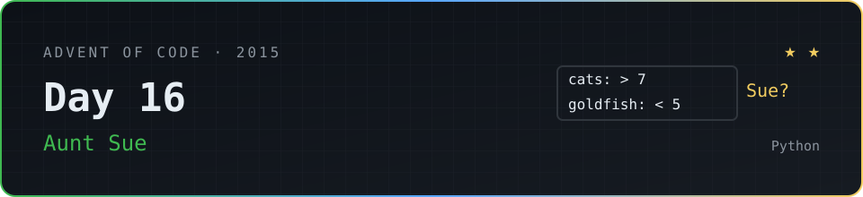
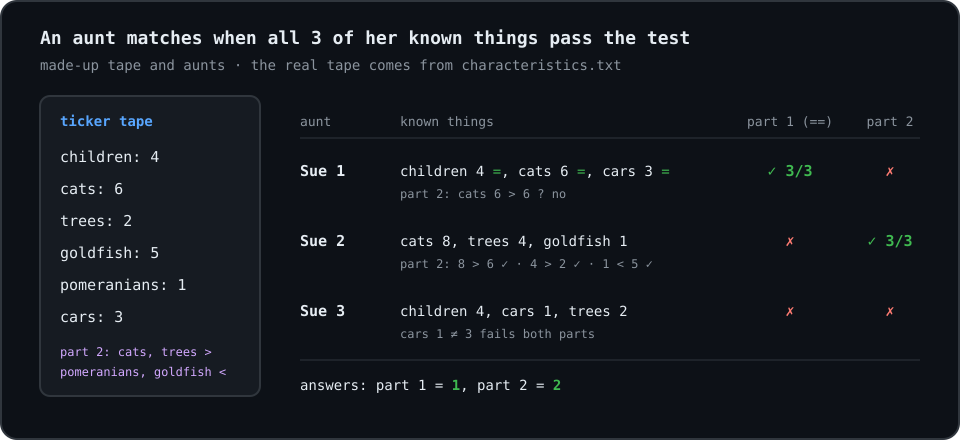

<div align="center">
  
</div>

> [!IMPORTANT]
> **The code was written 100% by a human.** Every line of the solutions in this repository was written by hand, without any kind of help from artificial intelligence: no generated code, no hints, no suggestions.
> AI was only used afterwards, to turn that finished, hand-written code into this README (the text and the diagrams).

## 🧩 The puzzle

You have 500 Aunts named Sue and want to thank the one who sent you a gift. A machine analyses the gift and prints a
**ticker tape** with counts of things (children, cats, dog breeds, goldfish, trees, cars, perfumes…).
For each aunt, the input lists only the **three** things you remember, e.g. `Sue 7: cats: 8, trees: 4, goldfish: 1`.

| Part | Question |
| :--: | -------- |
| ⭐ 1 | Which aunt's known things all equal the values on the tape? |
| ⭐ 2 | The machine is outdated: for `cats` and `trees` the real value is **greater** than the tape, for `pomeranians` and `goldfish` it is **fewer**, and the rest must be equal. Which aunt matches now? |

## 💡 The idea

A **linear scan with a filter**. Things that are missing from an aunt's list are unknown, so they never rule her out;
only her three known values are compared with the tape.

- **Part 1**: count how many of her known values are equal to the tape.
- **Part 2**: same, but compare `cats`/`trees` with `>` and `pomeranians`/`goldfish` with `<`.

An aunt matches as soon as the counter reaches 3, i.e. all her known values pass.

<div align="center">
  
</div>

## 🛠️ Implementations

| Language | Highlights |
| -------- | ---------- |
| [Python](./python) | Each aunt line is parsed with one regex that captures the number and three `name: value` pairs. The tape values come from a separate file, `characteristics.txt`, with one `name: value` per line (the list from the puzzle text). One `comparator(aunt_chars, only_equal)` handles both parts: `only_equal=True` is part 1. Both answers are printed while scanning, and the loop stops after two matches. |

```python
for char in aunt_chars:
    if not only_equal and char in fewer:
        if aunt_chars[char] < characteristics[char]:
            contains += 1
    elif not only_equal and char in greater:
        if aunt_chars[char] > characteristics[char]:
            contains += 1
    elif aunt_chars[char] == characteristics[char]:
        contains += 1

    if contains == 3:
        return True
```

## ⏱️ Complexity

| | Time | Memory |
| - | :--: | :----: |
| Part 1 | `O(n)` aunts × 3 checks | `O(n)` for the parsed list |
| Part 2 | `O(n)` | `O(n)` |

## ▶️ Running

The script reads `input.txt` (the aunts) and `characteristics.txt` (the tape) from the current directory.

```bash
cd python && python3 main.py
```
