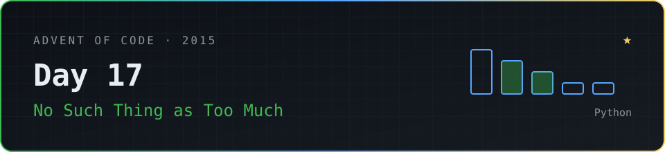
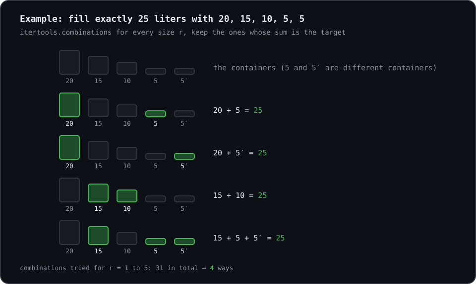

<div align="center">
  
</div>

> [!IMPORTANT]
> **The code was written 100% by a human.** Every line of the solutions in this repository was written by hand, without any kind of help from artificial intelligence: no generated code, no hints, no suggestions.
> AI was only used afterwards, to turn that finished, hand-written code into this README (the text and the diagrams).

## 🧩 The puzzle

The elves bought **150 liters** of eggnog and have a list of container sizes, one per line. Every container used must be
filled completely. Two containers of the same size are still different containers.

| Part | Question |
| :--: | -------- |
| ⭐ 1 | How many different combinations of containers can hold exactly 150 liters? |
| 2 | Find the minimum number of containers that can hold 150 liters. How many combinations use exactly that many? *(not solved in this repository)* |

## 💡 The idea

This is a **subset-sum count**, and the list of containers is short, so the solution simply checks every subset:
for every size `r` from 1 to `n`, go through all combinations of `r` containers and count those whose sum is the target.

`itertools.combinations` works on positions, not values, so two containers with the same size give two different
combinations.

<div align="center">
  
</div>

> [!NOTE]
> Only part 1 is solved here. Part 2 has not been solved yet.

## 🛠️ Implementations

| Language | Highlights |
| -------- | ---------- |
| [Python](./python) | Part 1 only. Reads every number in the file with `re.finditer(r'\d+', ...)`. The target is the constant `target = 150`. |

```python
for r in range(1, len(data) + 1):
    for comb in combinations(data, r):
        if sum(comb) == target:
            count += 1
```

## ⏱️ Complexity

| | Time | Memory |
| - | :--: | :----: |
| Part 1 | `O(2ⁿ · n)` (every subset, each summed) | `O(n)` |

## ▶️ Running

The script reads `input.txt` from the current directory.

```bash
cd python && python3 main.py
```
