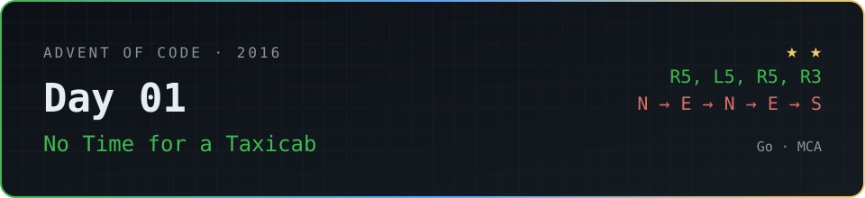
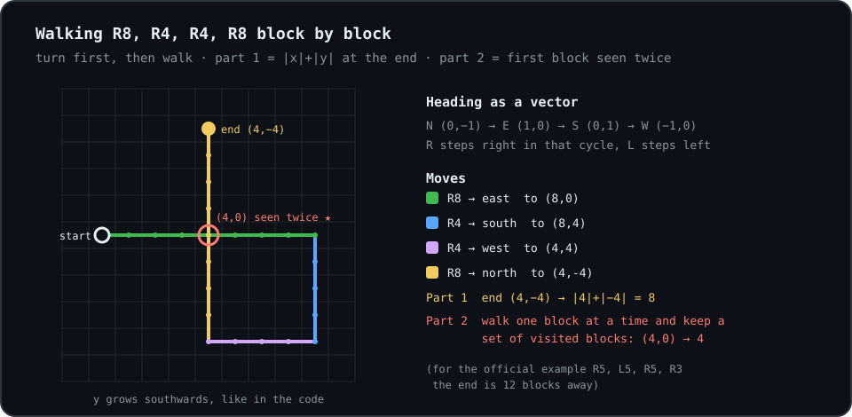

<div align="center">
  
</div>

> [!IMPORTANT]
> **The code was written 100% by a human.** Every line of the solutions in this repository was written by hand, without any kind of help from artificial intelligence: no generated code, no hints, no suggestions.
> AI was only used afterwards, to turn that finished, hand-written code into this README (the text and the diagrams).

## 🧩 The puzzle

You are dropped on a city grid facing north and get a list of instructions like `R2, L3`: turn right or left 90°, then walk that many blocks forward.

| Part | Question |
| :--: | -------- |
| ⭐ 1 | How many blocks away (Manhattan distance) is the place where the instructions end? |
| ⭐ 2 | How far away is the first block that you visit twice? |

## 💡 The idea

Keep a **position** and a **heading vector**. Turning is just rotating that vector through the cycle `N → E → S → W`, and walking adds `heading × blocks` to the position.

- **Part 1** only needs the final position: the answer is `|x| + |y|`.
- **Part 2** walks **one block at a time** (not one instruction at a time), because the first repeated location can be in the middle of a segment. Every block goes into a set, and the first block that is already in the set is the answer.

<div align="center">
  
</div>

## 🛠️ Implementations

| Language | Highlights |
| -------- | ---------- |
| [Go](./go) | Parses the line with the regex `(R\|L)(\d+)` into `Instruction`s. Headings are the four constant vectors `N`, `E`, `S`, `W`, and `rotateLeft` / `rotateRight` map one to the next with a `switch`. Part 2 uses a `map[Vector2]struct{}` as the visited set (the origin is added first) and leaves both loops with a labelled `break outer`. |
| [MCA](./mca) | Written in the author's own language [MCA](https://github.com/marcos-venicius/MCA). Scans the raw text character by character: `R` / `L` rotate the `(dx, dy)` pair in place (`R`: `(dx, dy) → (−dy, dx)`), then the following digits are read as the number of blocks. One pass solves both parts; visited blocks are stored as string keys built with `string.format(x, 'x', y)` until part 2 is found. |

```go
// part 2 in Go: step one block at a time and stop at the first repeat
for d := 0; d < i.blocks; d++ {
	pos.x += direction.x
	pos.y += direction.y

	if _, ok := visited[pos]; ok {
		ans = abs(pos.x) + abs(pos.y)

		break outer
	}

	visited[pos] = Empty
}
```

## ⏱️ Complexity

With `n` instructions and `B` total blocks walked:

| | Time | Memory |
| - | :--: | :----: |
| Part 1 | `O(n)` | `O(1)` |
| Part 2 | `O(B)` | `O(B)` for the visited set |

## ▶️ Running

The Go version opens `../input.txt` (the input sits in the day folder); the MCA version opens `./input.txt` relative to where it is run.

```bash
cd go && go run .      # Go
mca mca/main.mca       # MCA, run from the day folder
```
