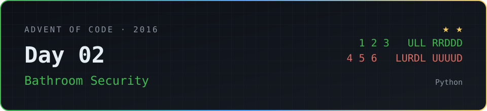
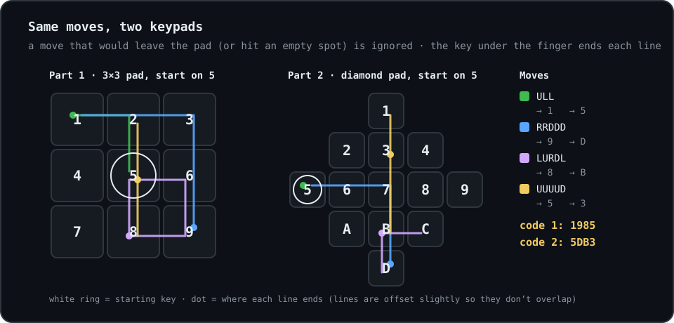

<div align="center">
  
</div>

> [!IMPORTANT]
> **The code was written 100% by a human.** Every line of the solutions in this repository was written by hand, without any kind of help from artificial intelligence: no generated code, no hints, no suggestions.
> AI was only used afterwards, to turn that finished, hand-written code into this README (the text and the diagrams).

## 🧩 The puzzle

The bathroom code is hidden in a list of moves. Each line is a string of `U`, `D`, `L`, `R`; you move your finger over a keypad one key per letter, ignoring any move that would leave the keypad, and press the key you are on when the line ends. The next line starts from that key.

| Part | Question |
| :--: | -------- |
| ⭐ 1 | What is the code on a normal 3×3 keypad (`1`–`9`), starting on `5`? |
| ⭐ 2 | What is the code on a diamond-shaped keypad (`1`–`9`, `A`–`D`), starting on `5`? |

## 💡 The idea

Model the keypad as a 2D grid where missing keys are `None`. A move is accepted only if the target cell is inside the grid **and** not empty; otherwise the finger stays put. The same simulation then works for both keypads, only the grid and the starting position change.

<div align="center">
  
</div>

## 🛠️ Implementations

| Language | Highlights |
| -------- | ---------- |
| [Python](./python) | A small `PadController` class holds the keypad, the position and a move table `{'U': (0, -1), ...}`. Part 1 uses a 3×3 grid of ints starting at `(1, 1)`; part 2 uses a 5×5 grid padded with `None`, starting at `(0, 2)`. |

```python
def move(self, movement):
    m = self.M[movement]

    nx = self.x + m[0]
    ny = self.y + m[1]

    if ny >= 0 and ny < len(self.keypad) and nx >= 0 and nx < len(self.keypad[ny]):
        if self.keypad[ny][nx] is not None:
            self.x = nx
            self.y = ny
```

## ⏱️ Complexity

With `m` moves in total:

| | Time | Memory |
| - | :--: | :----: |
| Part 1 | `O(m)` | `O(1)` |
| Part 2 | `O(m)` | `O(1)` |

## ▶️ Running

The script reads `./input.txt` from the current directory.

```bash
cd python && python3 main.py
```
