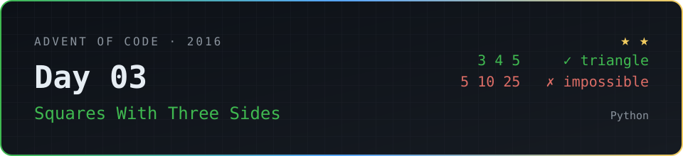
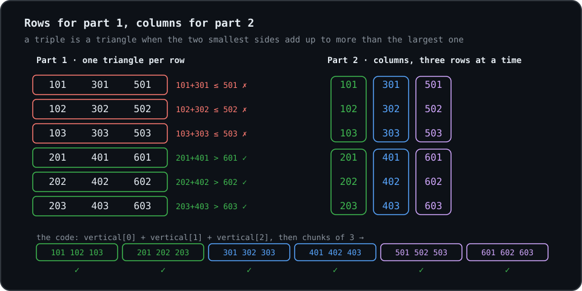

<div align="center">
  
</div>

> [!IMPORTANT]
> **The code was written 100% by a human.** Every line of the solutions in this repository was written by hand, without any kind of help from artificial intelligence: no generated code, no hints, no suggestions.
> AI was only used afterwards, to turn that finished, hand-written code into this README (the text and the diagrams).

## 🧩 The puzzle

The input is a list of rows with three numbers each, supposedly the side lengths of triangles. Many of them are impossible: in a valid triangle, the sum of any two sides must be larger than the remaining side.

| Part | Question |
| :--: | -------- |
| ⭐ 1 | How many of the rows are possible triangles? |
| ⭐ 2 | How many are possible if triangles are instead read **vertically**, three rows at a time in each column? |

## 💡 The idea

Checking all three inequalities is the same as one check after sorting: **the two smallest sides must add up to more than the largest one**.

- **Part 1** applies that check to every row.
- **Part 2** only changes how the numbers are grouped. The code collects each column into its own list, concatenates the three columns, and cuts that long list into groups of three consecutive values.

<div align="center">
  
</div>

## 🛠️ Implementations

| Language | Highlights |
| -------- | ---------- |
| [Python](./python) | Splits the whole file on whitespace into one flat list of ints and slices it into triples. Each part is a single list comprehension using `sum(sorted(t)[:-1]) > max(t)`. |

```python
part_one = len([t for t in data if sum(sorted(t)[:-1]) > max(t)])
```

## ⏱️ Complexity

With `n` triples:

| | Time | Memory |
| - | :--: | :----: |
| Part 1 | `O(n)` | `O(n)` |
| Part 2 | `O(n)` | `O(n)` |

## ▶️ Running

The script reads `./input.txt` from the current directory.

```bash
cd python && python3 main.py
```
