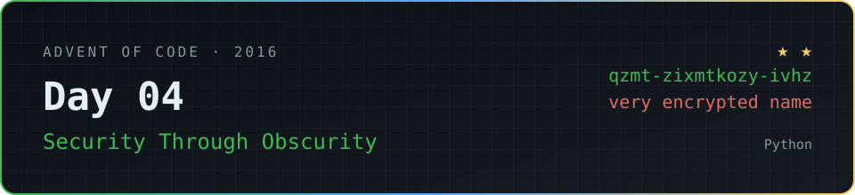
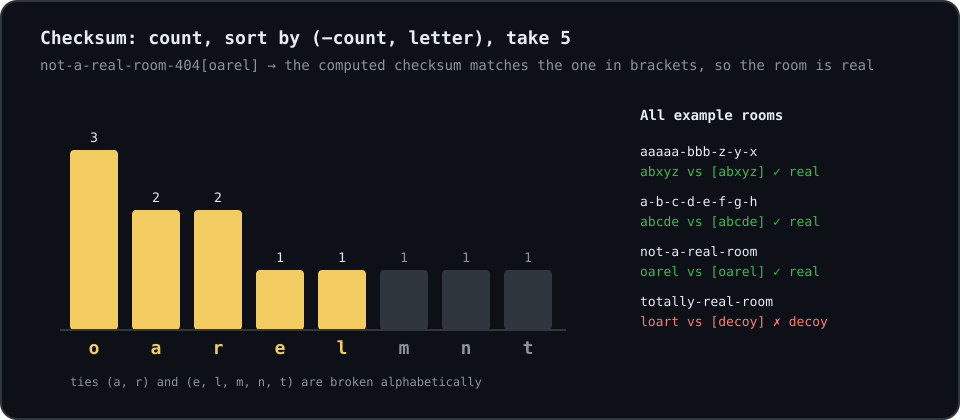
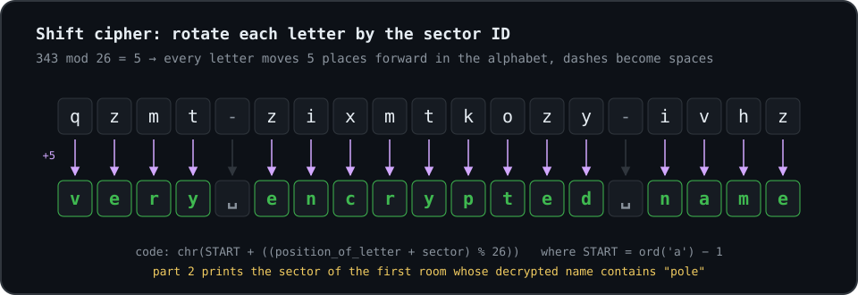

<div align="center">
  
</div>

> [!IMPORTANT]
> **The code was written 100% by a human.** Every line of the solutions in this repository was written by hand, without any kind of help from artificial intelligence: no generated code, no hints, no suggestions.
> AI was only used afterwards, to turn that finished, hand-written code into this README (the text and the diagrams).

## 🧩 The puzzle

Each line describes a room as an encrypted name made of dash-separated lowercase words, a numeric sector ID and a checksum in square brackets, like `aaaaa-bbb-z-y-x-123[abxyz]`. A room is *real* when its checksum is the five most common letters of the name, ties broken alphabetically. The names are encrypted with a shift cipher.

| Part | Question |
| :--: | -------- |
| ⭐ 1 | What is the sum of the sector IDs of the real rooms? |
| ⭐ 2 | What is the sector ID of the room where the North Pole objects are stored? |

## 💡 The idea

### Part 1: recompute the checksum

Count every letter of the name (dashes removed), sort the letters by **count descending, then alphabetically**, and keep the first five. A room is real when that string equals the checksum in brackets.

<div align="center">
  
</div>

### Part 2: undo the shift cipher

Every letter is rotated forward through the alphabet by the sector ID (so only `sector % 26` matters) and every dash becomes a space. The code decrypts the rooms in order and prints the sector of the first one whose decrypted name contains `pole`.

<div align="center">
  
</div>

## 🛠️ Implementations

| Language | Highlights |
| -------- | ---------- |
| [Python](./python) | A regex `([a-z-]+)-(\d+)\[([a-z]+)\]` splits each line into name, sector and checksum. `is_real` counts letters in a dict and sorts with the key `(-count[l], l)`. `decipher` works with the letter's position in the alphabet and a modulo 26. Part 2 decrypts every room (not only the real ones) and stops at the first match. |

```python
res = ''.join(sorted(count, key=lambda l: (-count[l], l))[:5])

return res == checksum
```

## ⏱️ Complexity

With `n` rooms and names of length `L`:

| | Time | Memory |
| - | :--: | :----: |
| Part 1 | `O(n · L)` (the sort is over at most 26 letters) | `O(n · L)` |
| Part 2 | `O(n · L)` | `O(L)` per decrypted name |

## ▶️ Running

The script reads `./input.txt` from the current directory.

```bash
cd python && python3 main.py
```
