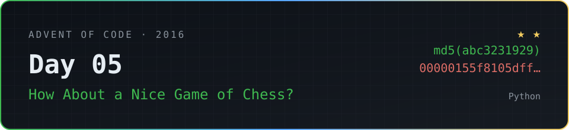
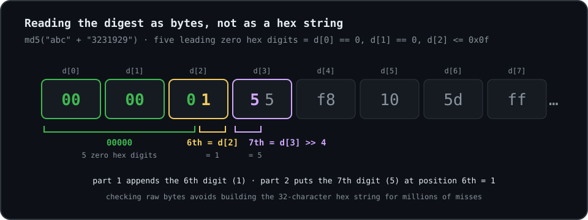
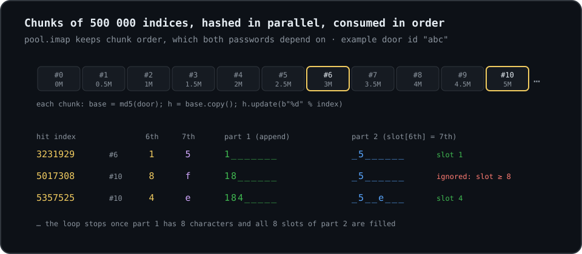

<div align="center">
  
</div>

> [!IMPORTANT]
> **The code was written 100% by a human.** Every line of the solutions in this repository was written by hand, without any kind of help from artificial intelligence: no generated code, no hints, no suggestions.
> AI was only used afterwards, to turn that finished, hand-written code into this README (the text and the diagrams).

## 🧩 The puzzle

An 8-character door password is found by hashing the door ID followed by an increasing index (`abc0`, `abc1`, ...) with MD5. Only hashes whose hex form starts with five zeros are "interesting".

| Part | Question |
| :--: | -------- |
| ⭐ 1 | The password is the 6th hex digit of the first eight interesting hashes, in order. What is it? |
| ⭐ 2 | Now the 6th digit is a **position** (0–7) and the 7th digit is the character to put there. Only the first hit for each position counts and positions `8`–`f` are ignored. What is the password? |

## 💡 The idea

The code hashes millions of candidates, so it keeps each hash cheap and spreads the work over all CPU cores.

- **Cheap test.** Instead of converting every digest to a hex string, it looks at raw bytes: five leading zero hex digits means `d[0] == 0`, `d[1] == 0` and `d[2] <= 0x0f`. Then the 6th digit is simply `d[2]` and the 7th is `d[3] >> 4`.
- **Cheap hashing.** The MD5 state of the door ID is computed once (`base`) and copied for every index, so only the digits of the index are fed to the hash each time.

<div align="center">
  
</div>

- **Parallel, but in order.** Indices are split into chunks of 500 000 and handed to a `multiprocessing.Pool`. `pool.imap` returns the chunk results in their original order, which matters because both passwords depend on the *order* of the hits. The main loop feeds both parts from the same stream of hits and stops when both passwords are complete.

<div align="center">
  
</div>

## 🛠️ Implementations

| Language | Highlights |
| -------- | ---------- |
| [Python](./python) | `scan_chunk` returns `(sixth, seventh)` pairs for one chunk. One pass over the ordered results fills `part_one` (append until 8 chars) and `part_two` (a list of 8 slots plus a set of the positions already taken). |

```python
for index in range(start, start + CHUNK_SIZE):
    h = base.copy()
    h.update(b'%d' % index)
    d = h.digest()

    if d[0] or d[1] or d[2] > 0x0f:
        continue

    hits.append((d[2], d[3] >> 4))
```

## ⏱️ Complexity

With `N` the index of the last hit needed (several million) and `P` worker processes:

| | Time | Memory |
| - | :--: | :----: |
| Both parts | `O(N)` hashes, about `O(N / P)` wall time | small: only the hits are sent back |

## ▶️ Running

The script reads `input.txt` from the current directory (the door ID, whitespace is stripped).

```bash
cd python && python3 main.py
```
