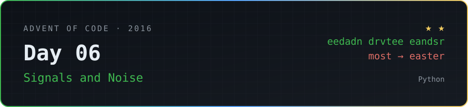
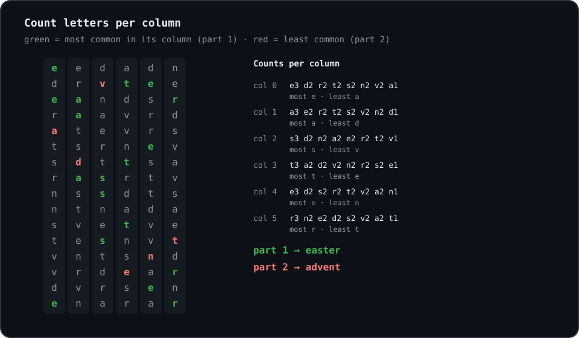

<div align="center">
  
</div>

> [!IMPORTANT]
> **The code was written 100% by a human.** Every line of the solutions in this repository was written by hand, without any kind of help from artificial intelligence: no generated code, no hints, no suggestions.
> AI was only used afterwards, to turn that finished, hand-written code into this README (the text and the diagrams).

## 🧩 The puzzle

A message is being sent over a noisy channel, so it was repeated many times and every copy got scrambled. All copies have the same length, and each position must be recovered from the letters seen at that position.

| Part | Question |
| :--: | -------- |
| ⭐ 1 | What is the message if each position uses its **most** common letter? |
| ⭐ 2 | What is the message if each position uses its **least** common letter? |

## 💡 The idea

Treat the input as a grid and count letters **column by column**. Sort every column's counts from most to least common: the first entry of each column gives part 1 and the last entry gives part 2.

<div align="center">
  
</div>

## 🛠️ Implementations

| Language | Highlights |
| -------- | ---------- |
| [Python](./python) | Builds one frequency dict per column, turns each into a list of `(letter, count)` sorted by count descending, and reads `x[0][0]` for part 1 and `x[-1][0]` for part 2 from the same sorted lists. |

```python
part_one = ''.join([x[0][0] for x in freq])
part_two = ''.join([x[-1][0] for x in freq])
```

## ⏱️ Complexity

With `n` messages of length `L`:

| | Time | Memory |
| - | :--: | :----: |
| Both parts | `O(n · L)` | `O(L · 26)` for the counts |

## ▶️ Running

The script reads `./input.txt` from the current directory.

```bash
cd python && python3 main.py
```
