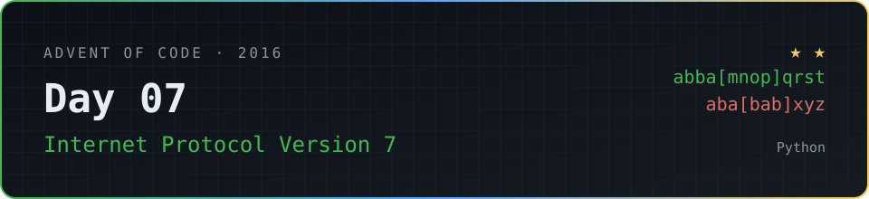
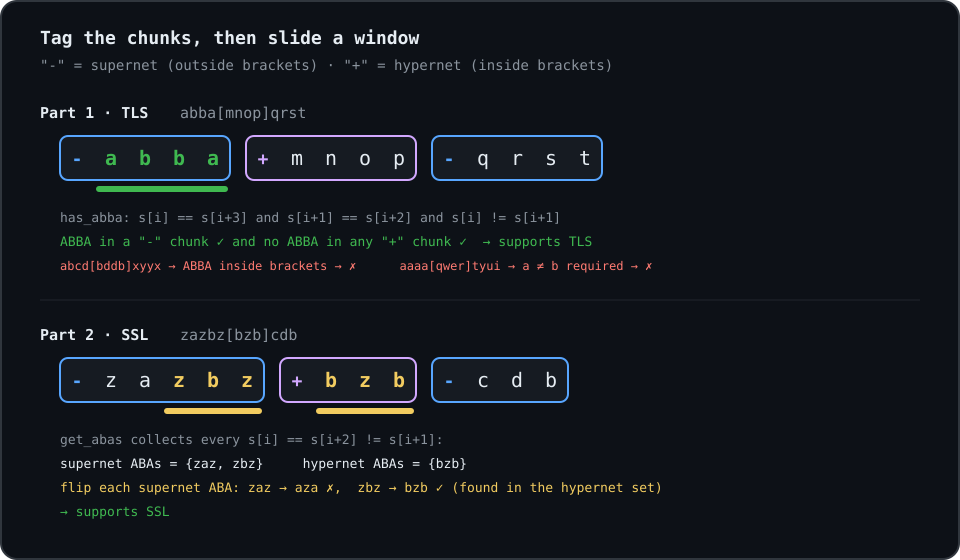

<div align="center">
  
</div>

> [!IMPORTANT]
> **The code was written 100% by a human.** Every line of the solutions in this repository was written by hand, without any kind of help from artificial intelligence: no generated code, no hints, no suggestions.
> AI was only used afterwards, to turn that finished, hand-written code into this README (the text and the diagrams).

## 🧩 The puzzle

Each line is an "IPv7" address: lowercase letters with some sections in square brackets (the *hypernet* sequences); everything outside brackets is the *supernet*.

- An **ABBA** is a 4-letter palindrome made of two different letters, like `abba` or `xyyx`.
- An **ABA** is a 3-letter pattern like `aba`, and its matching **BAB** is `bab`.

| Part | Question |
| :--: | -------- |
| ⭐ 1 | How many addresses support TLS: an ABBA outside brackets and **no** ABBA inside any brackets? |
| ⭐ 2 | How many support SSL: an ABA outside brackets whose corresponding BAB appears inside brackets? |

## 💡 The idea

First split the address into chunks and remember which side of the brackets each one is on. Then every check is a **sliding window** over each chunk on its own, so a pattern can never accidentally span a bracket.

- **Part 1** slides a 4-wide window looking for `s[i] == s[i+3]`, `s[i+1] == s[i+2]` and `s[i] != s[i+1]`. Any ABBA in a hypernet chunk rejects the address immediately.
- **Part 2** slides a 3-wide window and collects all ABAs into two sets (supernet and hypernet). The address supports SSL if flipping any supernet ABA (`aba → bab`) gives something in the hypernet set.

<div align="center">
  
</div>

## 🛠️ Implementations

| Language | Highlights |
| -------- | ---------- |
| [Python](./python) | `dissect_ip` walks the address once and starts a new chunk on every `[` (tagged `+`) and `]` (tagged `-`), so each chunk string carries its tag as the first character. `supports_tls` returns early on a hypernet ABBA; `supports_ssl` builds the two ABA sets and uses `any(...)` over the flipped supernet ones. |

```python
def supports_ssl(ip):
    supernet = set()
    hypernet = set()

    for chunk in ip:
        abas = get_abas(chunk[1:])

        if chunk[0] == '-':
            supernet.update(abas)
        else:
            hypernet.update(abas)

    return any(get_aba_reverse(aba) in hypernet for aba in supernet)
```

## ⏱️ Complexity

With `n` addresses of length `L`:

| | Time | Memory |
| - | :--: | :----: |
| Part 1 | `O(n · L)` | `O(L)` per address |
| Part 2 | `O(n · L)` | `O(L)` for the ABA sets |

## ▶️ Running

The script reads `./input.txt` from the current directory.

```bash
cd python && python3 main.py
```
