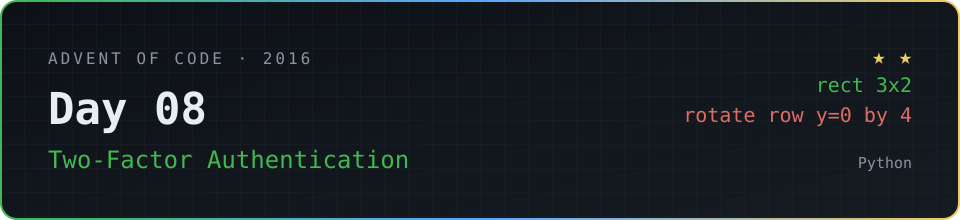
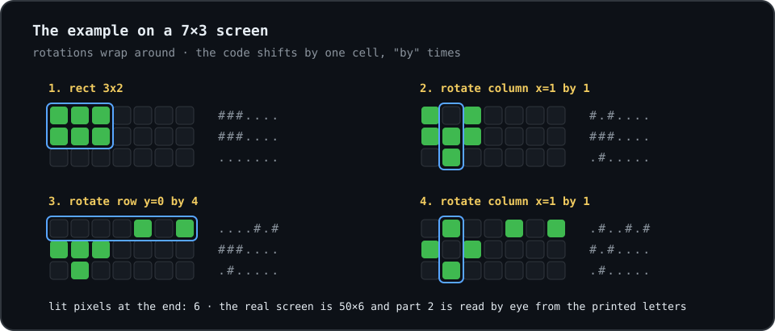

<div align="center">
  
</div>

> [!IMPORTANT]
> **The code was written 100% by a human.** Every line of the solutions in this repository was written by hand, without any kind of help from artificial intelligence: no generated code, no hints, no suggestions.
> AI was only used afterwards, to turn that finished, hand-written code into this README (the text and the diagrams).

## 🧩 The puzzle

A tiny 50×6 pixel screen starts with every pixel off. Three kinds of instructions change it:

- `rect AxB` turns on the `A`×`B` rectangle at the top-left corner;
- `rotate row y=A by B` shifts row `A` right by `B` pixels, wrapping around;
- `rotate column x=A by B` shifts column `A` down by `B` pixels, wrapping around.

| Part | Question |
| :--: | -------- |
| ⭐ 1 | How many pixels are lit after all instructions? |
| ⭐ 2 | What code (letters) does the screen display? |

## 💡 The idea

The screen is small, so a direct **simulation** on a 2D array is enough. Part 1 is the count of lit cells; part 2 is solved by printing the final screen and reading the letters.

<div align="center">
  
</div>

## 🛠️ Implementations

| Language | Highlights |
| -------- | ---------- |
| [Python](./python) | A hand-written character-by-character parser turns each line into a `Rect` or `Rotate` object. A rotation by `B` is done as `B` single-cell shifts, each carrying a `pending` value along the row or column and wrapping the last one back to index 0. Part 2 prints `❚` for lit pixels. A `TESTING` flag switches to `./test.txt` on a 7×3 screen. |

```python
for _ in range(rotate.destination):
    pending = M[rotate.origin][0]
    next = None

    for x in range(1, len(M[0])):
        next = M[rotate.origin][x]
        M[rotate.origin][x] = pending
        pending = next

    M[rotate.origin][0] = pending
```

## ⏱️ Complexity

With `n` instructions on a `W`×`H` screen:

| | Time | Memory |
| - | :--: | :----: |
| Simulation | `O(n · B · max(W, H))` with shifts of size `B` (plus `O(W · H)` per `rect`) | `O(W · H)` |

## ▶️ Running

The script reads `./input.txt` from the current directory (or `./test.txt` with `TESTING = True`).

```bash
cd python && python3 main.py
```
