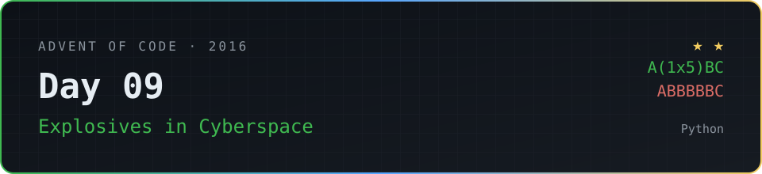
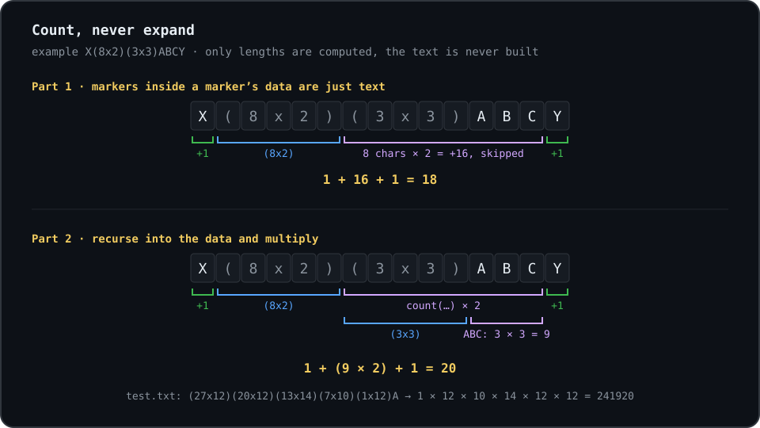

<div align="center">
  
</div>

> [!IMPORTANT]
> **The code was written 100% by a human.** Every line of the solutions in this repository was written by hand, without any kind of help from artificial intelligence: no generated code, no hints, no suggestions.
> AI was only used afterwards, to turn that finished, hand-written code into this README (the text and the diagrams).

## 🧩 The puzzle

A file is compressed with markers like `(AxB)`: take the next `A` characters after the marker and repeat them `B` times. Whitespace is ignored.

| Part | Question |
| :--: | -------- |
| ⭐ 1 | What is the decompressed length, if markers inside a marker's data are treated as plain text? |
| ⭐ 2 | What is the decompressed length in "version two", where markers inside the data are expanded too? |

## 💡 The idea

The fully decompressed text in part 2 is huge, so the solution **never builds it**. It only counts.

- **Part 1** walks the string once. A normal character adds `1`. A marker `(AxB)` adds `A × B` and jumps over its `A` data characters, so anything inside them is never looked at.
- **Part 2** uses recursion: the length of a marker's data is computed by counting that slice with the same function, and then multiplied by `B`. Nested markers simply multiply their way down.

<div align="center">
  
</div>

## 🛠️ Implementations

| Language | Highlights |
| -------- | ---------- |
| [Python](./python) | `parse_marker` reads `(length x repeat)` by hand and returns the offset right after `)`. Part 1 is a `while` loop over a global offset. Part 2 is `recursive_count(start, end, n)`, which sums a slice of the input and multiplies the result by `n`, the repeat of the marker that owns that slice. |

```python
def recursive_count(start, end, n):
    acc = 0
    cursor = start

    while cursor < end:
        if data[cursor] == '(':
            post_marker_offset, length, repeat = parse_marker(cursor)

            acc += recursive_count(post_marker_offset, post_marker_offset + length, repeat)

            cursor = post_marker_offset + length
        else:
            acc += 1
            cursor += 1

    return acc * n
```

## ⏱️ Complexity

With `n` the length of the compressed input:

| | Time | Memory |
| - | :--: | :----: |
| Part 1 | `O(n)` | `O(1)` extra |
| Part 2 | `O(n)` (every character is visited once, in exactly one slice) | `O(d)` stack, `d` = marker nesting depth |

## ▶️ Running

The script reads `./input.txt` from the current directory.

```bash
cd python && python3 main.py
```
