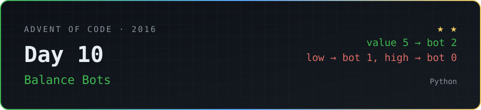
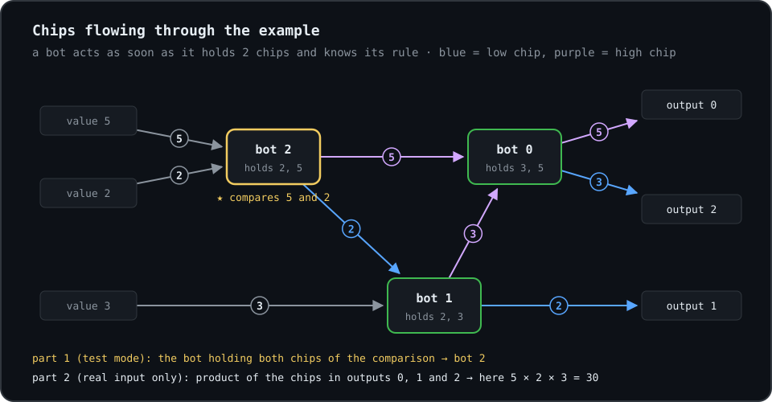

<div align="center">
  
</div>

> [!IMPORTANT]
> **The code was written 100% by a human.** Every line of the solutions in this repository was written by hand, without any kind of help from artificial intelligence: no generated code, no hints, no suggestions.
> AI was only used afterwards, to turn that finished, hand-written code into this README (the text and the diagrams).

## 🧩 The puzzle

Bots pass numbered microchips around. Some instructions put a chip into a bot (`value 5 goes to bot 2`); others say what a bot does once it holds two chips (`bot 2 gives low to bot 1 and high to bot 0`). Chips can also be given to numbered output bins.

| Part | Question |
| :--: | -------- |
| ⭐ 1 | Which bot is responsible for comparing the chips with values `61` and `17`? |
| ⭐ 2 | What do you get if you multiply the chips that end up in outputs `0`, `1` and `2`? |

## 💡 The idea

The instructions are not in execution order, so the solution is **event-driven**: every bot waits until it has both two chips *and* its rule, then fires. Firing hands the low and high chips to other bots (which may fire in turn) or to output bins. Feeding the instructions one by one in any order eventually runs the whole factory.

<div align="center">
  
</div>

Once everything has run, part 1 is the bot whose two chips are the requested pair and part 2 multiplies the contents of outputs `0`, `1` and `2`.

## 🛠️ Implementations

| Language | Highlights |
| -------- | ---------- |
| [Python](./python) | A token-by-token parser turns lines into `('value', (value, bot))` or `('transaction', {...})`. Each `Bot` keeps a list of `values`, a queue of `instructions` and two callbacks (`give_bot_cb`, `give_bin_cb`); `give_value` and `give_instruction` both call `__exec`, which fires when there are 2 values and a pending instruction. A bot keeps its chips after giving them away, so a final scan with `compare` finds the part 1 bot. A `TEST` flag switches to `./test.txt` and the pair `(2, 5)`, and skips part 2. |

```python
def give_value(self, value):
    self.values.append(value)

    self.__exec()

def __exec(self):
    if len(self.values) == 2 and len(self.instructions) > 0:
        self.exec_instruction()
```

## ⏱️ Complexity

With `n` instructions (each bot fires at most once):

| | Time | Memory |
| - | :--: | :----: |
| Both parts | `O(n)` | `O(n)` |

## ▶️ Running

The script reads `./input.txt` from the current directory (or `./test.txt` with `TEST = True`).

```bash
cd python && python3 main.py
```
