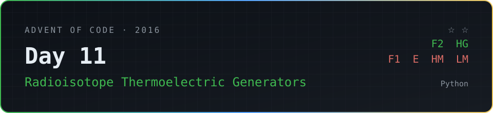
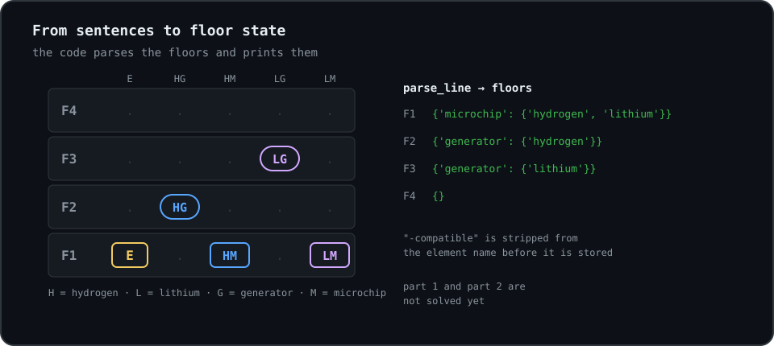

<div align="center">
  
</div>

> [!IMPORTANT]
> **The code was written 100% by a human.** Every line of the solutions in this repository was written by hand, without any kind of help from artificial intelligence: no generated code, no hints, no suggestions.
> AI was only used afterwards, to turn that finished, hand-written code into this README (the text and the diagrams).

## 🧩 The puzzle

A four-floor building holds pairs of radioisotope generators and microchips of different elements. You and an elevator start on the first floor, and everything has to be brought to the fourth floor. The elevator carries one or two items and needs at least one to move. A microchip gets fried if it is on a floor with another element's generator, unless its own generator is there too.

| Part | Question |
| :--: | -------- |
| 1 | What is the minimum number of elevator moves to bring every item to the fourth floor? *(not solved in this repository)* |
| 2 | The same, with two extra pairs of items added to the first floor. *(not solved in this repository)* |

> [!NOTE]
> Neither part is solved yet. The code in this folder **parses the input into a floor state and prints it**.

## 💡 The idea

The code is a parser. Each line (`The first floor contains a hydrogen-compatible microchip and a lithium-compatible microchip.`) is tokenised with a regex, the ordinal word becomes the floor index, and every `a <element> <kind>` group is added to a dict that maps the item kind (`microchip` / `generator`) to the set of elements. The `-compatible` suffix is removed from the element name before it is stored.

<div align="center">
  
</div>

## 🛠️ Implementations

| Language | Highlights |
| -------- | ---------- |
| [Python](./python) | Parsing only. `parse_line` walks the regex tokens with a cursor, skipping `The`, `floor`, `contains`, `a`, `and`, commas and the final period; `nothing relevant` gives an empty floor. The floors are then merged into a list indexed by floor number and printed. A `TEST` flag switches to `./test.txt`. |

```python
component = token().replace('-compatible', '')

cursor += 1 # skip component

kind = token()

cursor += 1 # skip kind

if kind not in data:
    data[kind] = set()

data[kind].add(component)
```

## ⏱️ Complexity

| | Time | Memory |
| - | :--: | :----: |
| Parsing | `O(n)` in the input size | `O(n)` |

## ▶️ Running

The script reads `./input.txt` from the current directory (or `./test.txt` with `TEST = True`) and prints the parsed floors.

```bash
cd python && python3 main.py
```
