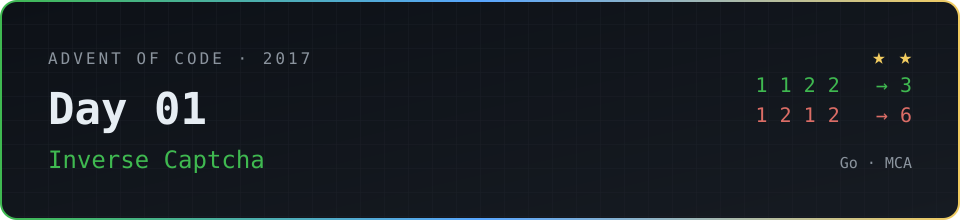
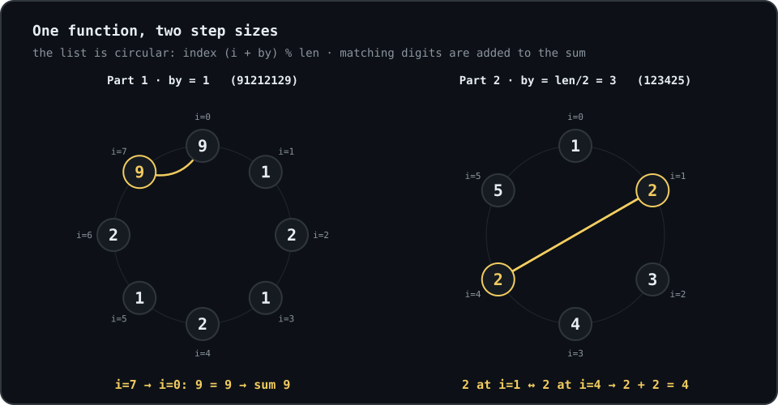

<div align="center">
  
</div>

> [!IMPORTANT]
> **The code was written 100% by a human.** Every line of the solutions in this repository was written by hand, without any kind of help from artificial intelligence: no generated code, no hints, no suggestions.
> AI was only used afterwards, to turn that finished, hand-written code into this README (the text and the diagrams).

## 🧩 The puzzle

The input is one long string of digits, and the list is **circular**: after the last digit comes the first one again.

| Part | Question |
| :--: | -------- |
| ⭐ 1 | What is the sum of all digits that match the **next** digit? |
| ⭐ 2 | What is the sum of all digits that match the digit **halfway around** the list? |

## 💡 The idea

Both parts are the same loop with a different step: compare digit `i` with digit `(i + by) % len` and add it to the sum when they are equal. Part 1 uses `by = 1`, part 2 uses `by = len / 2`. The modulo takes care of the wrap-around.

<div align="center">
  
</div>

## 🛠️ Implementations

| Language | Highlights |
| -------- | ---------- |
| [Go](./go) | `parseLine` turns the line into a `[]int` and a single helper `exploitCptcha(digits, by)` solves both parts (`by = 1` and `by = len/2`). Unit tests check the official examples for both parts. |
| [MCA](./mca) | Written in the author's own language [MCA](https://github.com/marcos-venicius/MCA). One loop computes both sums at once with inline `if ... else 0` expressions. The length used for the loop and the modulo is `len(INPUT) - 1`. As the file itself says, it is written compactly on purpose to exercise the language's syntax. |

```go
func exploitCptcha(digits *[]int, by int) (s int) {
	for i, d := range *digits {
		next := (i + by) % len(*digits)

		if d == (*digits)[next] {
			s += d
		}
	}

	return
}
```

## ⏱️ Complexity

| | Time | Memory |
| - | :--: | :----: |
| Part 1 | `O(n)` | `O(n)` for the digits (`O(1)` extra) |
| Part 2 | `O(n)` | `O(n)` for the digits (`O(1)` extra) |

## ▶️ Running

The Go version opens `../input.txt` (the input sits in the day folder); the MCA version opens `./input.txt` relative to where it is run.

```bash
cd go && go run .      # Go
cd go && go test       # Go tests with the examples
mca mca/main.mca       # MCA, run from the day folder
```
