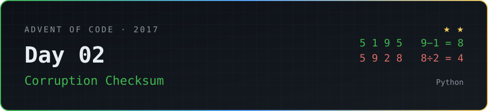
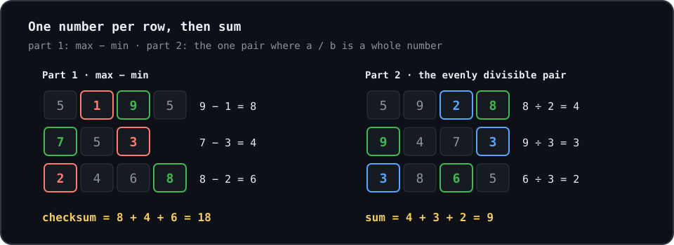

<div align="center">
  
</div>

> [!IMPORTANT]
> **The code was written 100% by a human.** Every line of the solutions in this repository was written by hand, without any kind of help from artificial intelligence: no generated code, no hints, no suggestions.
> AI was only used afterwards, to turn that finished, hand-written code into this README (the text and the diagrams).

## 🧩 The puzzle

The input is a spreadsheet: rows of whitespace-separated numbers. Each row contributes one value to a checksum.

| Part | Question |
| :--: | -------- |
| ⭐ 1 | What is the sum, over all rows, of the difference between the largest and the smallest value? |
| ⭐ 2 | Each row has exactly one pair where one number divides the other evenly. What is the sum of those quotients? |

## 💡 The idea

- **Part 1** is `max(row) - min(row)` for each row, summed.
- **Part 2** tries every ordered pair `(a, b)` of different positions in the row and stops at the first one where `a / b` is a whole number. Rows are short, so checking all pairs is cheap.

<div align="center">
  
</div>

## 🛠️ Implementations

| Language | Highlights |
| -------- | ---------- |
| [Python](./python) | Each row is split on single whitespace characters into ints. Part 1 is one `sum(...)` over `max(x) - min(x)`. Part 2's `get_divisors` uses two nested index loops and tests divisibility with `a / b % 1 == 0` before returning `a // b`. |

```python
def get_divisors(line):
    for i in range(len(line)):
        for j in range(len(line)):
            if i == j: continue

            a = line[i]
            b = line[j]

            if a / b % 1 == 0:
                return a // b

    return 0
```

## ⏱️ Complexity

With `r` rows of `k` numbers:

| | Time | Memory |
| - | :--: | :----: |
| Part 1 | `O(r · k)` | `O(r · k)` |
| Part 2 | `O(r · k²)` | `O(r · k)` |

## ▶️ Running

The script reads `./input.txt` from the current directory.

```bash
cd python && python3 main.py
```
