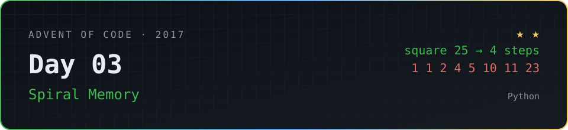
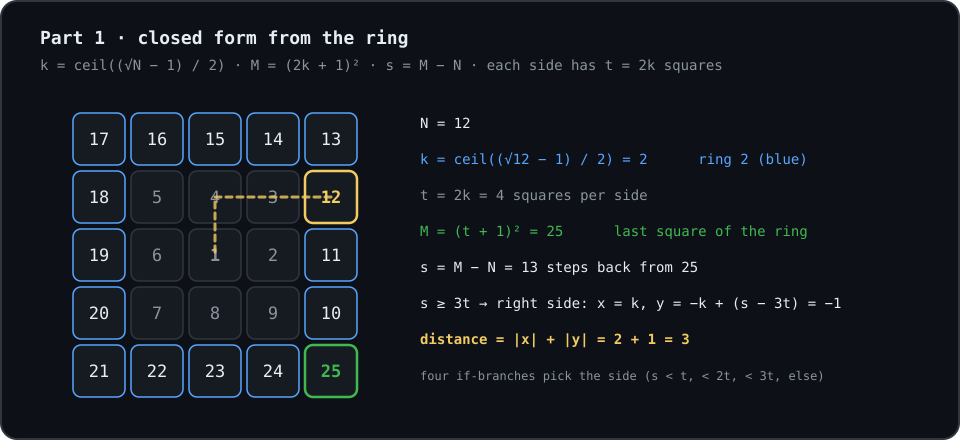
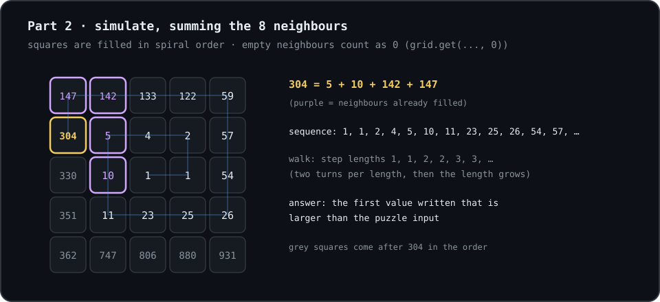

<div align="center">
  
</div>

> [!IMPORTANT]
> **The code was written 100% by a human.** Every line of the solutions in this repository was written by hand, without any kind of help from artificial intelligence: no generated code, no hints, no suggestions.
> AI was only used afterwards, to turn that finished, hand-written code into this README (the text and the diagrams).

## 🧩 The puzzle

Memory squares are numbered in a spiral that starts with `1` in the centre and winds outwards (`2` to the right, then up, left, down, ...). The puzzle input is a single number.

| Part | Question |
| :--: | -------- |
| ⭐ 1 | How many steps (Manhattan distance) is it from the input square back to square `1`? |
| ⭐ 2 | If each square instead stores the sum of all its already-filled neighbours (diagonals included), what is the first value written that is larger than the input? |

## 💡 The idea

### Part 1: closed form, no walking

The spiral is made of square **rings**. Ring `k` ends at the odd square `M = (2k + 1)²` in its corner, and each of its four sides has `t = 2k` squares. So for an input `N`:

1. find the ring: `k = ceil((√N − 1) / 2)`;
2. count how far `N` is behind the ring's last square: `s = M − N`;
3. `s` divided by `t` tells which side `N` is on, and the remainder where on that side, which gives its `(x, y)`;
4. the answer is `|x| + |y|`.

<div align="center">
  
</div>

### Part 2: simulate the spiral

Part 2 walks the spiral square by square. Segment lengths grow every two turns (`1, 1, 2, 2, 3, 3, ...`), each new square gets the sum of its 8 neighbours (missing ones count as `0`), and the walk stops at the first value above the input. The values grow very fast, so only a few dozen squares are ever written.

<div align="center">
  
</div>

## 🛠️ Implementations

| Language | Highlights |
| -------- | ---------- |
| [Python](./python) | Reads the puzzle number from standard input (`puzzle input> `), not from a file. Part 1 is the ring formula with four `if` branches for the sides. Part 2's `get_part_two` keeps a dict `grid` of `(x, y) → value` and returns as soon as a value exceeds the input. It also records every move, so running it with the argument `render` draws the spiral path with `turtle` (needs `tkinter`). |

```python
k = math.ceil((math.sqrt(N) - 1) / 2)
t = 2 * k
M = (t + 1) ** 2
s = M - N
```

## ⏱️ Complexity

| | Time | Memory |
| - | :--: | :----: |
| Part 1 | `O(1)` | `O(1)` |
| Part 2 | `O(m)`, `m` = squares written (tiny, since values grow exponentially) | `O(m)` |

## ▶️ Running

The script asks for the puzzle number on standard input.

```bash
cd python && python3 main.py           # type the number at the prompt
cd python && python3 main.py render    # same, then draws the spiral with turtle
```
