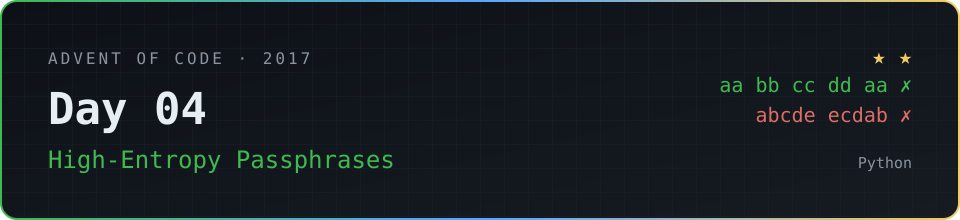
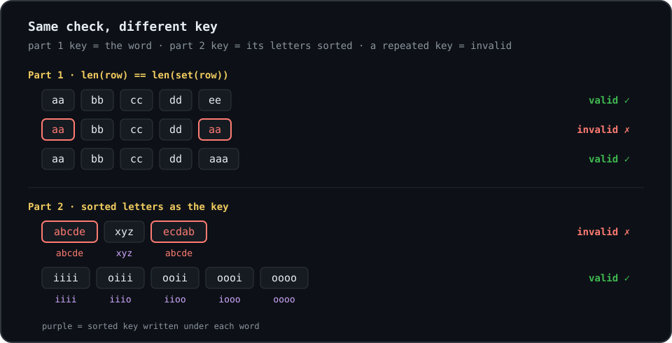

<div align="center">
  
</div>

> [!IMPORTANT]
> **The code was written 100% by a human.** Every line of the solutions in this repository was written by hand, without any kind of help from artificial intelligence: no generated code, no hints, no suggestions.
> AI was only used afterwards, to turn that finished, hand-written code into this README (the text and the diagrams).

## 🧩 The puzzle

Each line of the input is a passphrase made of lowercase words separated by spaces. The system checks whether passphrases are valid.

| Part | Question |
| :--: | -------- |
| ⭐ 1 | How many passphrases contain no duplicate words? |
| ⭐ 2 | How many passphrases contain no two words that are anagrams of each other? |

## 💡 The idea

Both parts ask "does any key repeat in this line?", only with a different key:

- **Part 1** uses the word itself: a line is valid when `len(row) == len(set(row))`.
- **Part 2** uses the word with its letters **sorted**. Two words are anagrams exactly when their sorted letters are equal, so anagrams collide in the set.

<div align="center">
  
</div>

## 🛠️ Implementations

| Language | Highlights |
| -------- | ---------- |
| [Python](./python) | Part 1 is a one-liner that sums booleans. Part 2's `check_anagrams` adds each sorted word to a set and returns early on the first collision. A `TEST` flag switches to `./test.txt`. |

```python
def check_anagrams(row):
    n = set()

    for word in row:
        s = ''.join(sorted([c for c in word]))

        if s in n:
            return True

        n.add(s)

    return False
```

## ⏱️ Complexity

With `w` words in total, each of length up to `L`:

| | Time | Memory |
| - | :--: | :----: |
| Part 1 | `O(w · L)` | `O(w · L)` |
| Part 2 | `O(w · L log L)` | `O(w · L)` |

## ▶️ Running

The script reads `./input.txt` from the current directory (or `./test.txt` with `TEST = True`).

```bash
cd python && python3 main.py
```
