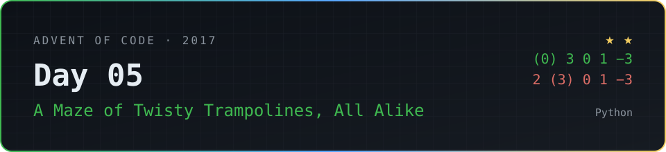
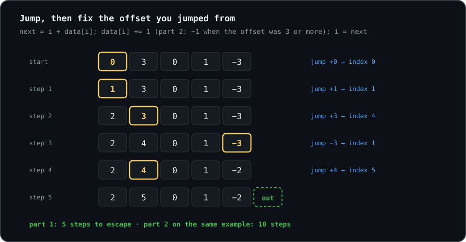

<div align="center">
  
</div>

> [!IMPORTANT]
> **The code was written 100% by a human.** Every line of the solutions in this repository was written by hand, without any kind of help from artificial intelligence: no generated code, no hints, no suggestions.
> AI was only used afterwards, to turn that finished, hand-written code into this README (the text and the diagrams).

## 🧩 The puzzle

The input is a list of jump offsets. Starting at the first one, you jump by the offset under you, and after each jump the offset you just left changes. The goal is to jump outside the list.

| Part | Question |
| :--: | -------- |
| ⭐ 1 | Each used offset increases by 1. How many steps does it take to leave the list? |
| ⭐ 2 | Offsets of 3 or more now decrease by 1, the others still increase by 1. How many steps now? |

## 💡 The idea

A straightforward **simulation**. The only detail is the order: compute the target from the *old* offset, then update the offset, then move. The two parts differ only in the update rule, so the loop takes that rule as a function.

<div align="center">
  
</div>

## 🛠️ Implementations

| Language | Highlights |
| -------- | ---------- |
| [Python](./python) | A single `solver(label, increase_lambda)` copies the offsets and runs the loop; part 1 passes `lambda _: 1`, part 2 passes `lambda curr: 1 if curr < 3 else -1`. A `TEST` flag switches to `./test.txt`. |

```python
while index >= 0 and index < len(data):
    iterations += 1

    next_index = index + data[index]

    data[index] += increase_lambda(data[index])

    index = next_index
```

## ⏱️ Complexity

With `n` offsets and `S` steps until escaping:

| | Time | Memory |
| - | :--: | :----: |
| Part 1 | `O(S)` | `O(n)` |
| Part 2 | `O(S)` (much larger `S` than part 1) | `O(n)` |

## ▶️ Running

The script reads `./input.txt` from the current directory (or `./test.txt` with `TEST = True`).

```bash
cd python && python3 main.py
```
