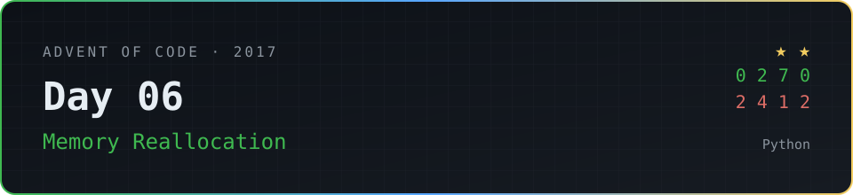
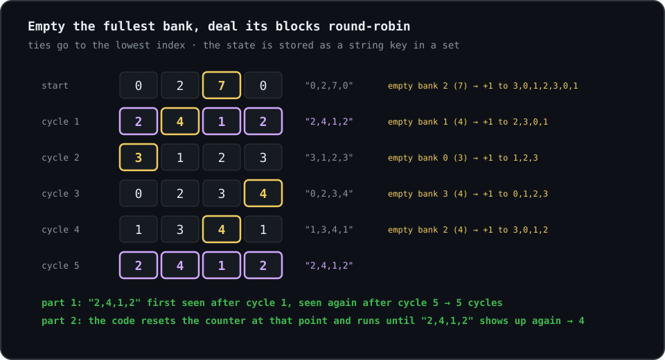

<div align="center">
  
</div>

> [!IMPORTANT]
> **The code was written 100% by a human.** Every line of the solutions in this repository was written by hand, without any kind of help from artificial intelligence: no generated code, no hints, no suggestions.
> AI was only used afterwards, to turn that finished, hand-written code into this README (the text and the diagrams).

## 🧩 The puzzle

A row of memory banks holds some blocks each. In every redistribution cycle, the bank with the most blocks (ties go to the lowest index) is emptied, and its blocks are handed out one at a time to the following banks, wrapping around to the start.

| Part | Question |
| :--: | -------- |
| ⭐ 1 | How many cycles happen before a configuration is produced that has been seen before? |
| ⭐ 2 | How many cycles long is the loop that starts at that repeated configuration? |

## 💡 The idea

This is **cycle detection** on a deterministic process. Keep a set of every configuration seen so far (as a string key). The first time a key is already in the set, the number of cycles done is the part 1 answer.

For part 2, the code remembers the repeated key, **resets the counter and keeps going** until that same key shows up again. The number of cycles in between is the loop length.

<div align="center">
  
</div>

## 🛠️ Implementations

| Language | Highlights |
| -------- | ---------- |
| [Python](./python) | `reallocate_banks_in_place` finds the first maximum with a strict `>` (so ties go to the lowest index) and deals the blocks with a wrapping index. States are joined with commas into a key for the `seen_before` set. A single `while True` loop handles both parts, using `part_one` first as a `(cycles, key)` tuple and then as the final number. A `TEST` flag switches to `test.txt`. |

```python
if key in seen_before:
    if part_one is None:
        part_one = (cycles, key)
        cycles = 0
    elif part_one[1] == key:
        part_one = part_one[0]
        part_two = cycles
        break
```

## ⏱️ Complexity

With `b` banks, `B` blocks in total and `C` cycles until the second appearance of the repeated state:

| | Time | Memory |
| - | :--: | :----: |
| Both parts | `O(C · (b + B))` | `O(C · b)` for the seen keys |

## ▶️ Running

The script reads `input.txt` from the current directory (or `test.txt` with `TEST = True`).

```bash
cd python && python3 main.py
```
