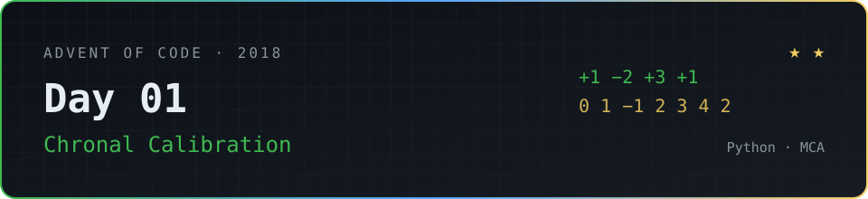
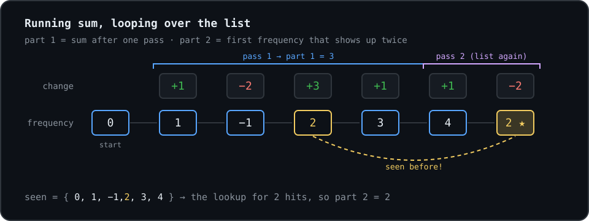

<div align="center">
  
</div>

> [!IMPORTANT]
> **The code was written 100% by a human.** Every line of the solutions in this repository was written by hand, without any kind of help from artificial intelligence: no generated code, no hints, no suggestions.
> AI was only used afterwards, to turn that finished, hand-written code into this README (the text and the diagrams).

## 🧩 The puzzle

A device starts at frequency `0` and receives a list of signed changes such as `+1`, `-2`, `+3`.
Each change is added to the current frequency.

| Part | Question |
| :--: | -------- |
| ⭐ 1 | What is the frequency after applying every change once? |
| ⭐ 2 | Applying the list over and over, which frequency is the first one to be reached twice? |

## 💡 The idea

Both parts are a **running sum** over the changes.

- **Part 1** is just the total of the list.
- **Part 2** keeps walking the list in a loop and remembers every frequency it has seen in a hash set. The first time the new frequency is already in the set, that is the answer. The list may need many passes before it happens, so the loop restarts from the first change each time.

<div align="center">
  
</div>

## 🛠️ Implementations

| Language | Highlights |
| -------- | ---------- |
| [Python](./python) | Splits the file into tokens and reads the sign by hand (`+` adds, `-` subtracts, anything else raises). Part 2 applies each change, then looks the new frequency up in the `seen` set before storing it, and the outer `while part_two == 0` loop keeps going until a repeat is found. |
| [MCA](./mca) | Written in the author's own language [MCA](https://github.com/marcos-venicius/MCA). A small hand-written parser walks the file with a cursor (skip `\n`, skip the sign, read digits) and `as_int` turns each slice into a number. Part 2 looks the current frequency up in a dictionary, stores it and then applies the next change, with `?` as the "not found yet" marker. |

```python
# Python, part 2: loop over the list until a frequency repeats
while part_two == 0:
    for freq in data:
        ...
        if acc in seen:
            part_two = acc
            break

        seen.add(acc)
```

## ⏱️ Complexity

| | Time | Memory |
| - | :--: | :----: |
| Part 1 | `O(n)` | `O(n)` for the parsed list |
| Part 2 | `O(n · p)`, where `p` is the number of passes until a repeat | `O(n · p)` for the seen set |

## ▶️ Running

Each solution reads `input.txt` from the current directory.

```bash
cd python && python3 main.py   # Python
cd mca    && mca main.mca      # MCA
```
