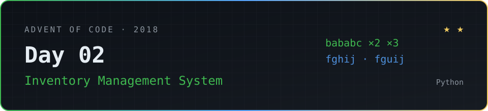
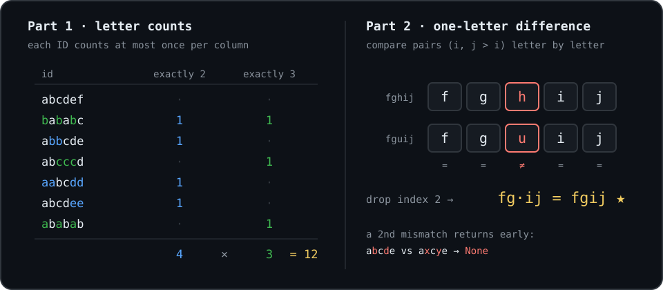

<div align="center">
  
</div>

> [!IMPORTANT]
> **The code was written 100% by a human.** Every line of the solutions in this repository was written by hand, without any kind of help from artificial intelligence: no generated code, no hints, no suggestions.
> AI was only used afterwards, to turn that finished, hand-written code into this README (the text and the diagrams).

## 🧩 The puzzle

The input is a list of box IDs made of lowercase letters, all of the same length.

| Part | Question |
| :--: | -------- |
| ⭐ 1 | Count the IDs that contain some letter exactly twice, and the IDs that contain some letter exactly three times. What is the product of the two counts (the checksum)? |
| ⭐ 2 | Two IDs differ in exactly one position. Which letters do they have in common (the ID with that one position removed)? |

## 💡 The idea

**Part 1** is a letter histogram per ID. An ID adds at most `1` to the "twos" counter and at most `1` to the
"threes" counter, no matter how many letters repeat (for example `aabcdd` has two pairs but counts once).

**Part 2** compares every pair of IDs position by position. As soon as a second mismatch shows up the pair is
rejected; a pair with exactly one mismatch is the answer, and its common letters are the ID with that index cut out.

<div align="center">
  
</div>

## 🛠️ Implementations

| Language | Highlights |
| -------- | ---------- |
| [Python](./python) | `count_letters` builds a dict of counts and returns a `(has_three, has_two)` pair of `0`/`1` flags. `get_common_between_two_correct_box_ids` remembers the index of the first difference, returns `None` on a second one, and otherwise slices that index out. Part 2 loops over pairs `j > i` and exits the program at the first match. |

```python
for i in range(len(a)):
    if a[i] != b[i]:
        # more than one difference
        if diff_at != -1:
            return None
        diff_at = i
```

## ⏱️ Complexity

With `n` IDs of length `L`:

| | Time | Memory |
| - | :--: | :----: |
| Part 1 | `O(n · L)` | `O(L)` per ID |
| Part 2 | `O(n² · L)` in the worst case | `O(L)` |

## ▶️ Running

The solution reads `input.txt` from the current directory.

```bash
cd python && python3 main.py
```
