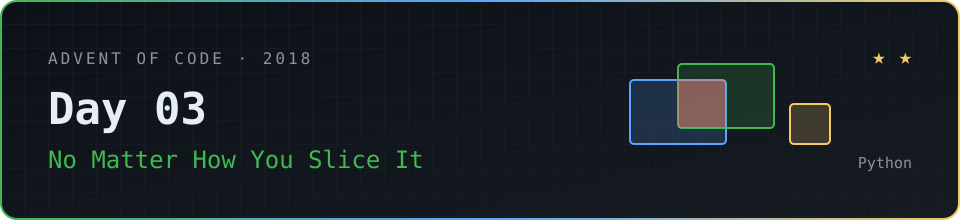
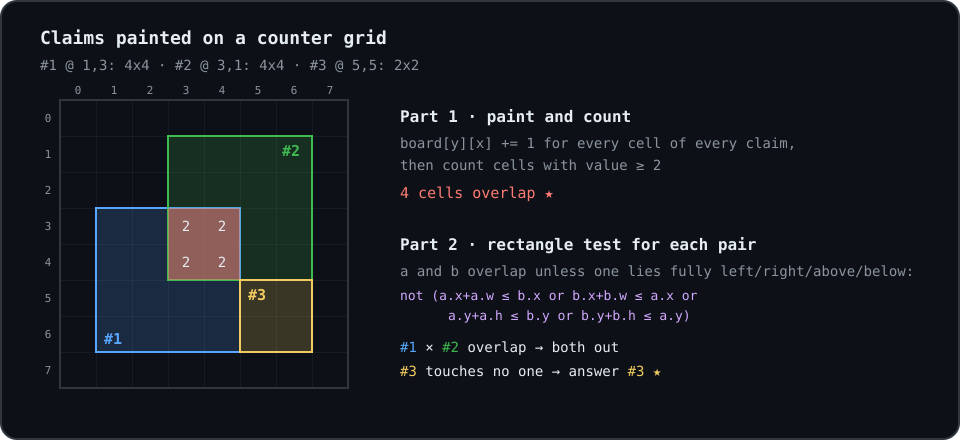

<div align="center">
  
</div>

> [!IMPORTANT]
> **The code was written 100% by a human.** Every line of the solutions in this repository was written by hand, without any kind of help from artificial intelligence: no generated code, no hints, no suggestions.
> AI was only used afterwards, to turn that finished, hand-written code into this README (the text and the diagrams).

## 🧩 The puzzle

Elves claim rectangles on a large square of fabric. Each line looks like `#1 @ 1,3: 4x4`:
claim id, the left and top offsets, then the width and height.

| Part | Question |
| :--: | -------- |
| ⭐ 1 | How many square inches of fabric are inside two or more claims? |
| ⭐ 2 | Which single claim does not overlap any other claim? |

## 💡 The idea

**Part 1** paints the claims onto a grid of counters: every cell of every claim gets `+1`. The answer is the
number of cells whose counter ended at `2` or more.

**Part 2** does not need the grid. Two axis-aligned rectangles overlap unless one is completely to the left,
right, above or below the other, so a pair can be tested with four comparisons. The claim that passes the test
against every other claim is the answer.

<div align="center">
  
</div>

## 🛠️ Implementations

| Language | Highlights |
| -------- | ---------- |
| [Python](./python) | Parses each line with `re.findall(r'\d+', ...)` into a `Claim`. Part 1 sizes the board from the largest `x + w` and `y + h` and paints it. Part 2 wraps each claim in an `OverlapCheckDispatcher` that remembers the last index it checked: claims are added one at a time and, after each addition, every dispatcher resumes from where it stopped, so each claim is compared with all the others once and stops as soon as it finds an overlap. The first claim still marked eligible is returned. |

```python
def check_overlap(self, overlap: OverlapCheckDispatcher):
    a = self.claim
    b = overlap.claim

    return not (
        a.x + a.w <= b.x or
        b.x + b.w <= a.x or
        a.y + a.h <= b.y or
        b.y + b.h <= a.y
    )
```

## ⏱️ Complexity

With `n` claims covering a `W × H` board and total claimed area `A`:

| | Time | Memory |
| - | :--: | :----: |
| Part 1 | `O(A + W · H)` | `O(W · H)` |
| Part 2 | `O(n²)` pair tests | `O(n)` |

## ▶️ Running

By default the script reads the example `test.txt`; pass `run` to use `input.txt`. Both are read from the current directory.

```bash
cd python && python3 main.py       # example
cd python && python3 main.py run   # real input
```
