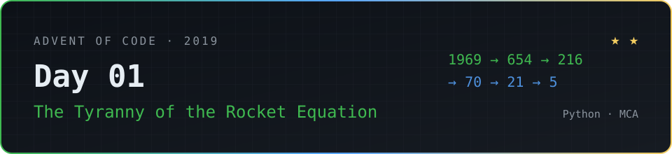
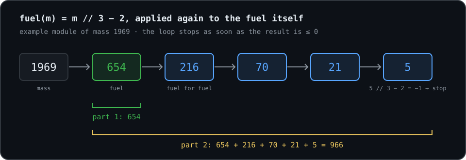

<div align="center">
  
</div>

> [!IMPORTANT]
> **The code was written 100% by a human.** Every line of the solutions in this repository was written by hand, without any kind of help from artificial intelligence: no generated code, no hints, no suggestions.
> AI was only used afterwards, to turn that finished, hand-written code into this README (the text and the diagrams).

## 🧩 The puzzle

Every module of a spacecraft has a mass (one number per line). The fuel a mass needs is the mass divided
by three, rounded down, minus two.

| Part | Question |
| :--: | -------- |
| ⭐ 1 | What is the sum of the fuel needed by all modules? |
| ⭐ 2 | Fuel has mass too and needs its own fuel, and so on. What is the total once that extra fuel is included? |

## 💡 The idea

- **Part 1** applies `m // 3 - 2` once per module and sums the results.
- **Part 2** keeps applying the same formula to the fuel just computed, adding every positive result, and
  stops when the formula gives zero or less. For the example mass `1969` the chain is `654, 216, 70, 21, 5`.

<div align="center">
  
</div>

## 🛠️ Implementations

| Language | Highlights |
| -------- | ---------- |
| [Python](./python) | Two list comprehensions over the split input: one for the single step, one calling `calc_fuel`, a `while` loop that accumulates fuel while the next value is positive. |
| [MCA](./mca) | Written in the author's own language [MCA](https://github.com/marcos-venicius/MCA). Builds the number list with `map`/`filter` over the lines and solves both parts in the same `for` loop. Integer division is done with `as_int(of / 3)`. |

```python
def calc_fuel(of):
    result = 0
    of = of // 3 - 2

    while of > 0:
        result += of

        of = of // 3 - 2

    return result
```

## ⏱️ Complexity

| | Time | Memory |
| - | :--: | :----: |
| Part 1 | `O(n)` | `O(n)` for the parsed list |
| Part 2 | `O(n · log m)`, `m` being the largest mass | `O(n)` |

## ▶️ Running

Each solution reads `input.txt` from the current directory.

```bash
cd python && python3 main.py   # Python
cd mca    && mca main.mca      # MCA
```
