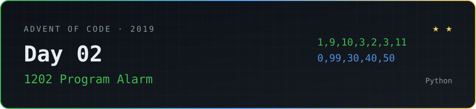
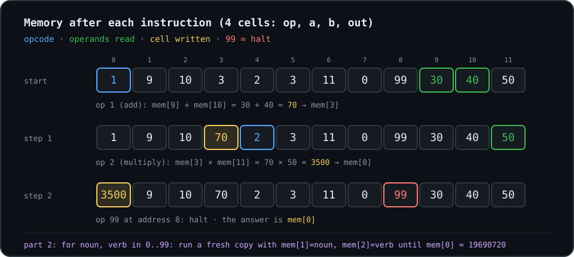

<div align="center">
  
</div>

> [!IMPORTANT]
> **The code was written 100% by a human.** Every line of the solutions in this repository was written by hand, without any kind of help from artificial intelligence: no generated code, no hints, no suggestions.
> AI was only used afterwards, to turn that finished, hand-written code into this README (the text and the diagrams).

## 🧩 The puzzle

The input is an **Intcode** program: a comma-separated list of integers that is also the computer's memory.
Starting at address `0`, an instruction is four cells `op, a, b, out`: opcode `1` stores `mem[a] + mem[b]` into
`mem[out]`, opcode `2` stores the product, and `99` halts. Then the pointer moves forward by four.

| Part | Question |
| :--: | -------- |
| ⭐ 1 | Set address `1` to `12` and address `2` to `2`, run the program. What is left at address `0`? |
| ⭐ 2 | Which pair `noun` (address `1`) and `verb` (address `2`), each from `0` to `99`, makes the program leave `19690720` at address `0`? Answer `100 · noun + verb`. |

## 💡 The idea

**Part 1** is a direct simulation: a cursor, an `if` per opcode, and a step of four.

**Part 2** has only `100 × 100` candidate inputs, so it tries them all. Because the program rewrites its own
memory, every attempt must run on a **fresh copy** of the original memory.

<div align="center">
  
</div>

## 🛠️ Implementations

| Language | Highlights |
| -------- | ---------- |
| [Python](./python) | Split in three files: `main.py` reads the input, patches addresses `1` and `2` to `12` and `2`, and hands a copy (`data[::]`) to each part; `one.py` runs the program once; `two.py` has the same interpreter in `run_logic` plus `find_solution`, which loops over every `noun`/`verb`, copies the memory with `memory[::]`, and returns `100 * noun + verb` on the first match. A `TEST` flag in `main.py` (set to `False`) chooses between `test.txt` without the patching and `input.txt` with it. |

```python
for noun in range(0, 100):
    for verb in range(0, 100):
        data = memory[::]

        data[1] = noun
        data[2] = verb

        result = run_logic(data)

        if result == target:
            return 100 * noun + verb
```

## ⏱️ Complexity

With a program of `n` cells:

| | Time | Memory |
| - | :--: | :----: |
| Part 1 | `O(n)` | `O(n)` |
| Part 2 | `O(100² · n)` in the worst case | `O(n)` per copy |

## ▶️ Running

The solution reads `input.txt` from the current directory (and imports `one.py` and `two.py` from it).

```bash
cd python && python3 main.py
```
