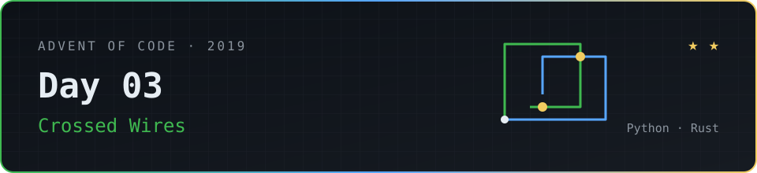
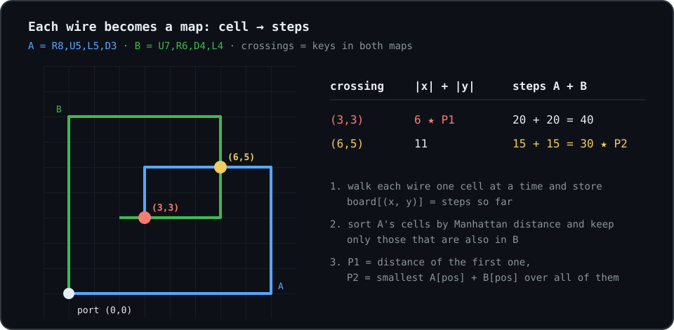

<div align="center">
  
</div>

> [!IMPORTANT]
> **The code was written 100% by a human.** Every line of the solutions in this repository was written by hand, without any kind of help from artificial intelligence: no generated code, no hints, no suggestions.
> AI was only used afterwards, to turn that finished, hand-written code into this README (the text and the diagrams).

## 🧩 The puzzle

Two wires start at the same port on a grid. Each wire is a list of moves like `R8,U5,L5,D3`
(direction and length). The wires cross at some cells.

| Part | Question |
| :--: | -------- |
| ⭐ 1 | What is the Manhattan distance from the port to the closest crossing? |
| ⭐ 2 | What is the smallest combined number of steps both wires take to reach a crossing? |

## 💡 The idea

Walk each wire one cell at a time and store every visited cell in a hash map `cell → steps taken so far`.
The crossings are simply the keys present in **both** maps.

- **Part 1**: sort the first wire's cells by `|x| + |y|`, keep those that the second wire also visited, and
  take the first one.
- **Part 2**: over the same crossings, take the minimum of `stepsA[cell] + stepsB[cell]`.

<div align="center">
  
</div>

## 🛠️ Implementations

| Language | Highlights |
| -------- | ---------- |
| [Python](./python) | `expand_wire` fills a dict keyed by `(x, y)` using a `DELTAS` table (`U` is `y - 1`). The cells of wire one are sorted by Manhattan distance and lazily filtered with `filter(...)`; the loop records the first distance and the smallest step sum. Also prints the run time. |
| [Rust](./rust) | Same plan with a `Direction` enum and a `HashMap<Pos, i32>`. `Pos` implements `Ord` by Manhattan distance, so `sort_by(cmp)` orders the cells, then `filter(contains_key)` keeps the crossings. Also prints the run time. |

```rust
for i in 1..=*units {
    x += dx;
    y += dy;

    board.insert(Pos { x, y }, steps + i);
}
```

## ⏱️ Complexity

With `L` the total length of both wires (number of cells walked):

| | Time | Memory |
| - | :--: | :----: |
| Part 1 | `O(L log L)` (sorting the cells) | `O(L)` |
| Part 2 | `O(L)` on top of part 1 | `O(L)` |

## ▶️ Running

Both versions read the example `test.txt` by default.

```bash
cd python && python3 main.py run                       # Python, reads input.txt ("run" switches from test.txt)
cd rust   && rustc -O main.rs && ./main input.txt      # Rust, the file name is the first argument
```
