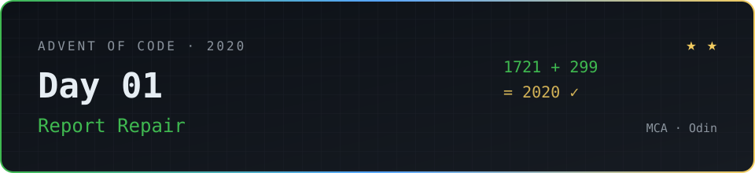
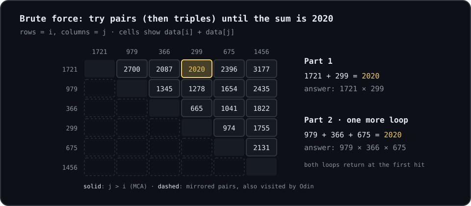

<div align="center">
  
</div>

> [!IMPORTANT]
> **The code was written 100% by a human.** Every line of the solutions in this repository was written by hand, without any kind of help from artificial intelligence: no generated code, no hints, no suggestions.
> AI was only used afterwards, to turn that finished, hand-written code into this README (the text and the diagrams).

## 🧩 The puzzle

The expense report is a list of numbers, one per line.

| Part | Question |
| :--: | -------- |
| ⭐ 1 | Find the two entries that sum to `2020`. What is their product? |
| ⭐ 2 | Find the three entries that sum to `2020`. What is their product? |

## 💡 The idea

The list is small, so both parts use **nested loops**: two loops for pairs, three for triples. The first
combination whose sum is `2020` is returned immediately.

<div align="center">
  
</div>

## 🛠️ Implementations

| Language | Highlights |
| -------- | ---------- |
| [MCA](./mca) | Written in the author's own language [MCA](https://github.com/marcos-venicius/MCA). Split into modules: `parser.mca` walks the text with a cursor and converts each line with `as_int`, `core.mca` exports `part_one` and `part_two`, and `main.mca` imports both and takes the input path as an argument. The inner loops use ranges `[i + 1, len(data)]`, so each pair or triple is tried only once. |
| [Odin](./odin) | Reads the file with `os.read_entire_file`, parses each line with `strconv.parse_int` into a `[dynamic]int`. Every loop runs over the full list and skips the index of the loop just outside it (`j == i`, then `k == j`). |

```
pub_part_two = \(data, as) -> {
  for i : len(data)
    for j : [i + 1, len(data)]
      for k : [j + 1, len(data)]
        if (data[i] + data[j] + data[k] == as) return data[i] * data[j] * data[k]
}
```

## ⏱️ Complexity

| | Time | Memory |
| - | :--: | :----: |
| Part 1 | `O(n²)` | `O(n)` |
| Part 2 | `O(n³)` | `O(n)` |

## ▶️ Running

Both versions take the input file as their only argument.

```bash
cd mca  && mca main.mca input.txt        # MCA
cd odin && odin run . -- input.txt       # Odin
```
