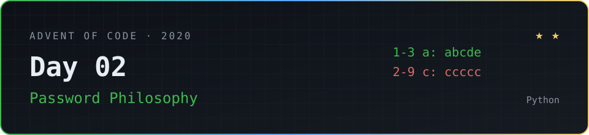
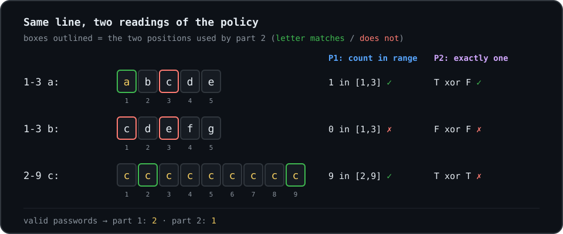

<div align="center">
  
</div>

> [!IMPORTANT]
> **The code was written 100% by a human.** Every line of the solutions in this repository was written by hand, without any kind of help from artificial intelligence: no generated code, no hints, no suggestions.
> AI was only used afterwards, to turn that finished, hand-written code into this README (the text and the diagrams).

## 🧩 The puzzle

Each line holds a policy and a password, like `1-3 a: abcde`. The two numbers and the letter are read
differently in each part.

| Part | Question |
| :--: | -------- |
| ⭐ 1 | The letter must appear between `lo` and `hi` times (inclusive). How many passwords are valid? |
| ⭐ 2 | The numbers are 1-based positions; **exactly one** of them must hold the letter. How many passwords are valid? |

## 💡 The idea

Both parts are a per-line predicate, summed over all lines.

- **Part 1**: count the occurrences of the letter and check `lo ≤ count ≤ hi`.
- **Part 2**: check the two positions and combine them with **XOR**, which is true when exactly one matches.

<div align="center">
  
</div>

## 🛠️ Implementations

| Language | Highlights |
| -------- | ---------- |
| [Python](./python) | `parse_line` splits on spaces into `(min, max, char, password)`. Part 1 uses `collections.Counter`, with `count.get(char, -1)` so a missing letter fails the lower bound. Part 2 shifts the positions to 0-based and uses `^` on the two booleans. Each part is a `sum(...)` of booleans. |

```python
def is_password_valid_2(info):
    p1, p2, char, passwd = info
    p1, p2 = p1 - 1, p2 - 1

    return (passwd[p1] == char) ^ (passwd[p2] == char)
```

## ⏱️ Complexity

With `n` lines and passwords of length up to `L`:

| | Time | Memory |
| - | :--: | :----: |
| Part 1 | `O(n · L)` | `O(L)` per line |
| Part 2 | `O(n)` | `O(1)` per line |

## ▶️ Running

By default the script reads the example `test.txt`; pass `run` to use `input.txt`. Both are read from the current directory.

```bash
cd python && python3 main.py       # example
cd python && python3 main.py run   # real input
```
