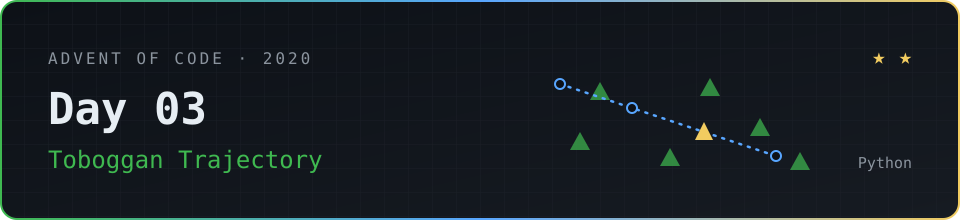
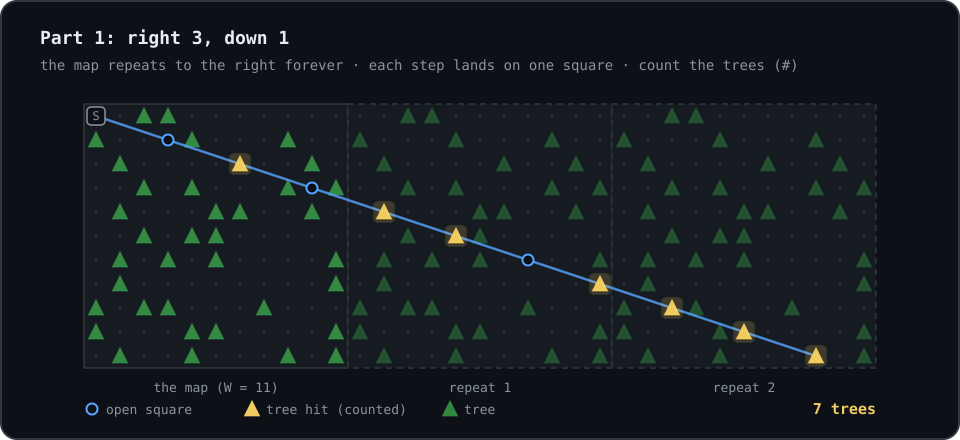
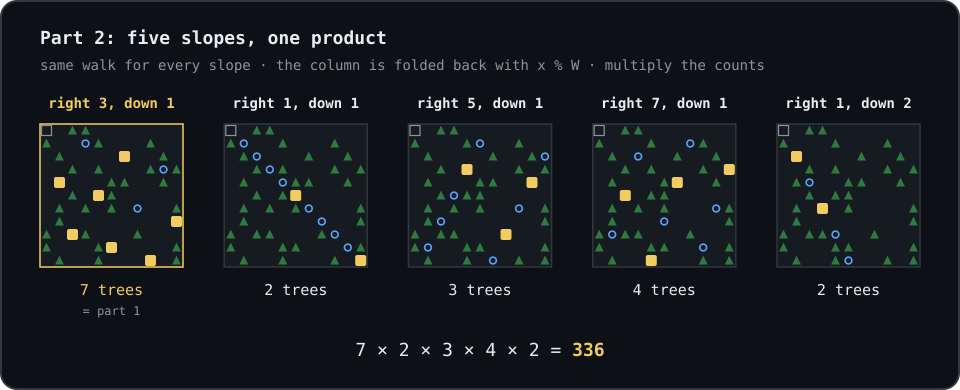

<div align="center">
  
</div>

> [!IMPORTANT]
> **The code was written 100% by a human.** Every line of the solutions in this repository was written by hand, without any kind of help from artificial intelligence: no generated code, no hints, no suggestions.
> AI was only used afterwards, to turn that finished, hand-written code into this README (the text and the diagrams).

## 🧩 The puzzle

The input is a map of a snowy slope: `.` is an open square and `#` is a tree. The pattern shown is only a small piece of the real area, because it repeats to the right forever. A toboggan starts at the top left corner and goes down the slope following a fixed step (so many squares right, so many down) until it passes the bottom row.

| Part | Question |
| :--: | -------- |
| ⭐ 1 | Going right 3 and down 1 at each step, how many trees does the toboggan hit? |
| ⭐ 2 | Do the same for five slopes (right 1/down 1, right 3/down 1, right 5/down 1, right 7/down 1, right 1/down 2). What is the product of the five tree counts? |

## 💡 The idea

Both parts use the same walk, `run_slopes_logic(DX, DY)`: start at `(0, 0)`, move `DX` columns right and `DY` rows down, and count the squares that are `#`. The walk stops as soon as the next row would be past the bottom of the map.

The map is never copied to the right. Because the pattern repeats, the new column is simply folded back into the map with `% W` (the map width), and only the row needs a bounds check.

### Part 1

The walk with the default slope, right 3 and down 1. Drawn on the example with the map repeated, the toboggan lands on 10 squares and 7 of them are trees:

<div align="center">
  
</div>

### Part 2

The same function runs for the other four slopes, and the part 1 count is reused as the starting value of the product. With the column wrapped by `% W`, every walk stays inside the original 11 × 11 map:

<div align="center">
  
</div>

## 🛠️ Implementations

| Language | Highlights |
| -------- | ---------- |
| [Python](./python) | Reads the map as a list of strings and stores its size in `W` and `H`. One function, `run_slopes_logic(DX=3, DY=1)`, walks a slope with the column wrapped by `% W`. Part 1 calls it with the defaults; part 2 calls it for `(1, 1)`, `(5, 1)`, `(7, 1)` and `(1, 2)` and multiplies the results, starting from `part_one`. |

```python
nx = (x + DX) % W # right DX wrap at the end because the board keeps repeating
                  # in its width indefinitely so the next col when it finishes
                  # is always the first which began the board.
ny = y + DY       # down DY

# <> is it inside the board?

if ny >= H: # only the y because we don't care about the x
    break
```

## ⏱️ Complexity

For a map of `H` rows and `W` columns:

| | Time | Memory |
| - | :--: | :----: |
| Part 1 | `O(H)` (one step per row) | `O(H · W)` to hold the map |
| Part 2 | `O(H)` for each of the slopes | `O(H · W)` to hold the map |

## ▶️ Running

The script reads `./test.txt` by default, and `./input.txt` when `run` is passed. Both paths are relative to the current directory, so run it from the `python` folder.

```bash
cd python
python3 main.py        # example, reads ./test.txt
python3 main.py run    # real input, reads ./input.txt
```
