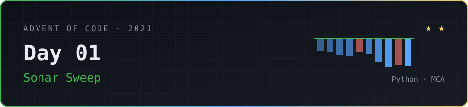
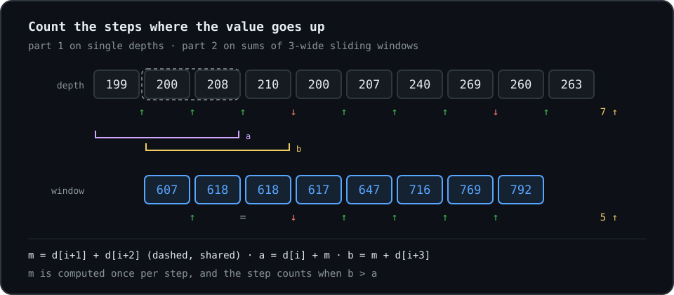

<div align="center">
  
</div>

> [!IMPORTANT]
> **The code was written 100% by a human.** Every line of the solutions in this repository was written by hand, without any kind of help from artificial intelligence: no generated code, no hints, no suggestions.
> AI was only used afterwards, to turn that finished, hand-written code into this README (the text and the diagrams).

## 🧩 The puzzle

A sonar sweep reports a list of sea floor depths, one per line.

| Part | Question |
| :--: | -------- |
| ⭐ 1 | How many measurements are larger than the previous one? |
| ⭐ 2 | Using sums of three consecutive measurements (a sliding window), how many sums are larger than the previous sum? |

## 💡 The idea

**Part 1** compares each depth with its neighbour on the left and counts the increases.

**Part 2** compares two windows that overlap: `a = d[i] + d[i+1] + d[i+2]` and `b = d[i+1] + d[i+2] + d[i+3]`.
The two middle values are shared, so the code computes that middle `m` once and builds both sums from it.

<div align="center">
  
</div>

## 🛠️ Implementations

| Language | Highlights |
| -------- | ---------- |
| [Python](./python) | Reads all numbers with `re.split`, then two plain index loops. |
| [MCA](./mca) | Written in the author's own language [MCA](https://github.com/marcos-venicius/MCA). Builds the list with `map`/`filter`/`as_int`; the loops mirror the Python version line by line, using the range `[1, len(data)]` for part 1. |

```python
for i in range(len(data) - 3):
    m = data[i + 1] + data[i + 2]

    a = data[i] + m
    b = m + data[i + 3]

    if b > a:
        part_two += 1
```

## ⏱️ Complexity

| | Time | Memory |
| - | :--: | :----: |
| Part 1 | `O(n)` | `O(n)` for the parsed list |
| Part 2 | `O(n)` | `O(n)` |

## ▶️ Running

Each solution reads `input.txt` from the current directory.

```bash
cd python && python3 main.py   # Python
cd mca    && mca main.mca      # MCA
```
