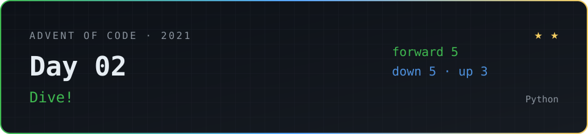
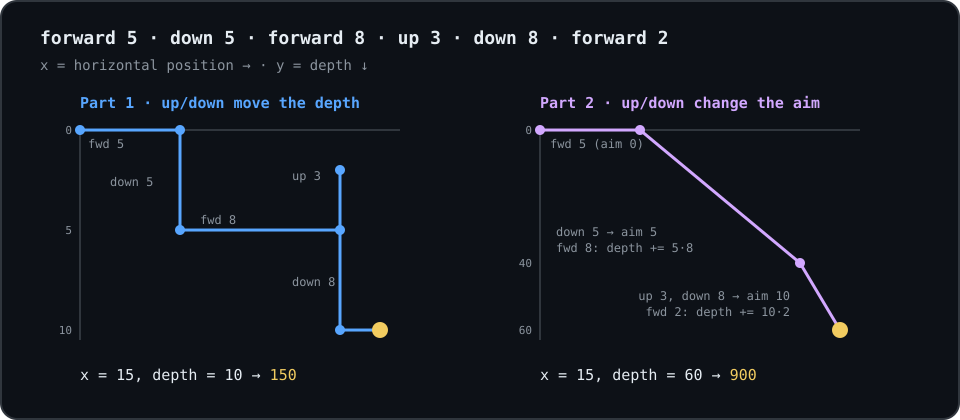

<div align="center">
  
</div>

> [!IMPORTANT]
> **The code was written 100% by a human.** Every line of the solutions in this repository was written by hand, without any kind of help from artificial intelligence: no generated code, no hints, no suggestions.
> AI was only used afterwards, to turn that finished, hand-written code into this README (the text and the diagrams).

## 🧩 The puzzle

The submarine follows a list of commands: `forward X`, `down X` and `up X`. It starts at horizontal
position `0` and depth `0`.

| Part | Question |
| :--: | -------- |
| ⭐ 1 | `forward` moves horizontally, `down`/`up` change the depth. What is final horizontal position × final depth? |
| ⭐ 2 | `down`/`up` now change an **aim**, and `forward X` moves `X` horizontally and `aim · X` deeper. Same question. |

## 💡 The idea

Both parts are a tiny state machine run over the commands once.

- **Part 1** state: `(x, depth)`.
- **Part 2** state: `(x, depth, aim)`. Only `forward` changes the position; it uses whatever aim the previous
  `down`/`up` commands left behind, so the path becomes a set of slanted lines.

<div align="center">
  
</div>

## 🛠️ Implementations

| Language | Highlights |
| -------- | ---------- |
| [Python](./python) | Parses each line into `(direction, units)` and handles the commands with a `match` statement (Python 3.10+). One function per part. |

```python
match direction:
    case 'forward':
        X += units
        Y += AIM * units
    case 'down':
        AIM += units
    case 'up':
        AIM -= units
```

## ⏱️ Complexity

| | Time | Memory |
| - | :--: | :----: |
| Part 1 | `O(n)` | `O(n)` for the parsed list |
| Part 2 | `O(n)` | `O(n)` |

## ▶️ Running

By default the script reads the example `test.txt`; pass `run` to use `input.txt`. Both are read from the current directory.

```bash
cd python && python3 main.py       # example
cd python && python3 main.py run   # real input
```
