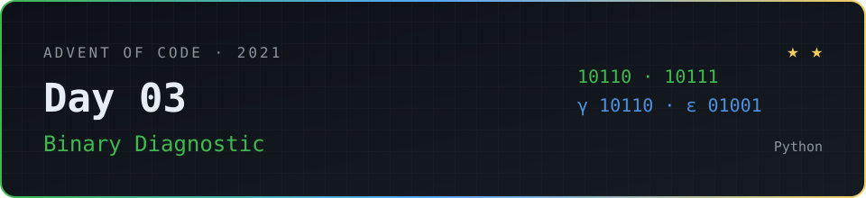
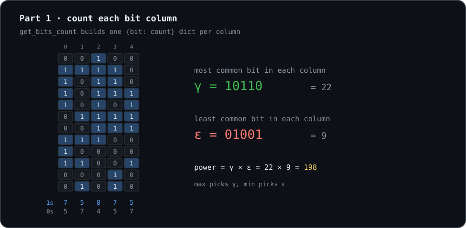
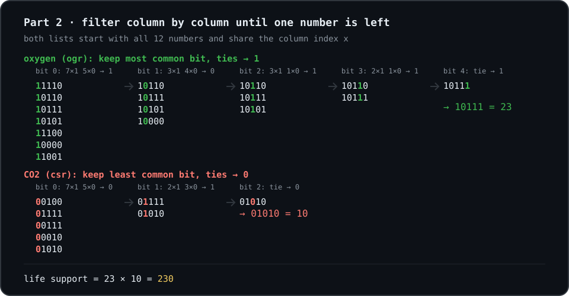

<div align="center">
  
</div>

> [!IMPORTANT]
> **The code was written 100% by a human.** Every line of the solutions in this repository was written by hand, without any kind of help from artificial intelligence: no generated code, no hints, no suggestions.
> AI was only used afterwards, to turn that finished, hand-written code into this README (the text and the diagrams).

## 🧩 The puzzle

The diagnostic report is a list of binary numbers of the same width.

| Part | Question |
| :--: | -------- |
| ⭐ 1 | Build **gamma** from the most common bit of each column and **epsilon** from the least common. What is gamma × epsilon? |
| ⭐ 2 | Find the **oxygen generator rating** and the **CO2 scrubber rating** by filtering the list column by column. What is their product? |

## 💡 The idea

### Part 1 · column counts

Count how many `0`s and `1`s appear in each column. Picking the majority bit per column gives gamma; picking the
minority bit gives epsilon.

<div align="center">
  
</div>

### Part 2 · filter until one number remains

Starting from the full list, look at column `0`, recount the bits **among the numbers still left**, and keep only
the numbers that have the wanted bit there. Then move to the next column, and stop when one number is left.

- Oxygen keeps the **most** common bit, and `1` on a tie.
- CO2 keeps the **least** common bit, and `0` on a tie.

<div align="center">
  
</div>

## 🛠️ Implementations

| Language | Highlights |
| -------- | ---------- |
| [Python](./python) | Every row is a list of characters. `get_bits_count` returns one `{bit: count}` dict per column; part 1 picks `max`/`min` by count and converts with `int(..., 2)`. In part 2 `check_rating` sorts the two keys of the current column by count (least common first, most common second), and one `while` loop filters both lists side by side using a shared column index `x`; a list that is already down to one number is returned unchanged. |

```python
keys = sorted(count.keys(), key=lambda key: count[key])

least_common = keys[0]
most_common = keys[1]

are_equal = count[most_common] == count[least_common]
```

## ⏱️ Complexity

With `n` numbers of `w` bits:

| | Time | Memory |
| - | :--: | :----: |
| Part 1 | `O(n · w)` | `O(w)` |
| Part 2 | `O(n · w²)` in the worst case (a full recount per column) | `O(n)` |

## ▶️ Running

By default the script reads the example `test.txt`; pass `run` to use `input.txt`. Both are read from the current directory.

```bash
cd python && python3 main.py       # example
cd python && python3 main.py run   # real input
```
