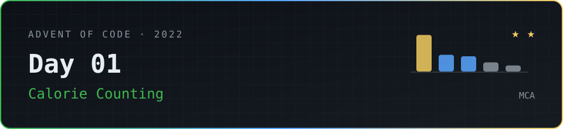
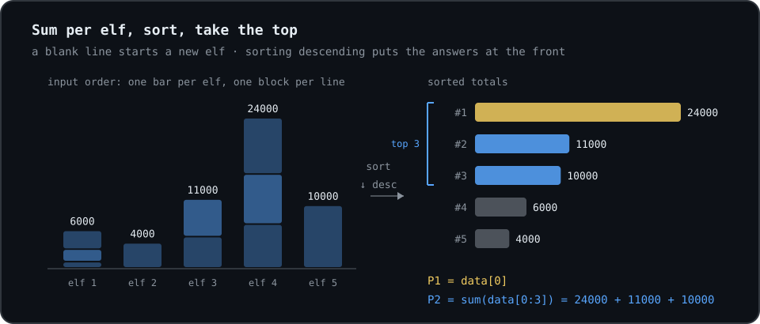

<div align="center">
  
</div>

> [!IMPORTANT]
> **The code was written 100% by a human.** Every line of the solutions in this repository was written by hand, without any kind of help from artificial intelligence: no generated code, no hints, no suggestions.
> AI was only used afterwards, to turn that finished, hand-written code into this README (the text and the diagrams).

## 🧩 The puzzle

The elves list the calories of every snack they carry, one number per line.
A blank line separates one elf's list from the next.

| Part | Question |
| :--: | -------- |
| ⭐ 1 | How many calories does the elf carrying the most calories have? |
| ⭐ 2 | How many calories do the top three elves carry in total? |

## 💡 The idea

Turn the input into one total per elf, then sort those totals from largest to smallest.

- **Part 1** is the first total after sorting.
- **Part 2** is the sum of the first three totals.

<div align="center">
  
</div>

## 🛠️ Implementations

| Language | Highlights |
| -------- | ---------- |
| [MCA](./mca) | Written in the author's own language [MCA](https://github.com/marcos-venicius/MCA). The list of totals starts as `[0]`: every number is added to the last total and every blank line appends a fresh `0`. One `sort` with a descending comparator answers both parts. |

```r
data = [0]

for _, line : lines if (line == '') append(data, 0) else data[-1] += as_int(line)

data = sort(data, \(a, b) -> b - a)

println('P1:', data[0])
println('P2:', sum(data[0:3]))
```

## ⏱️ Complexity

With `n` lines and `e` elves:

| | Time | Memory |
| - | :--: | :----: |
| Parse | `O(n)` | `O(e)` |
| Both parts | `O(e log e)` for the sort | `O(e)` |

## ▶️ Running

The solution reads `./input.txt` from the current directory.

```bash
cd mca && mca main.mca    # MCA
```
