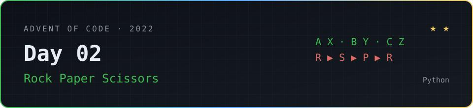
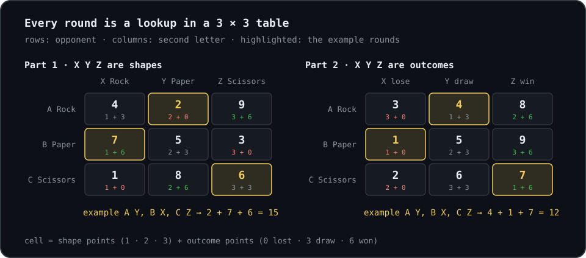

<div align="center">
  
</div>

> [!IMPORTANT]
> **The code was written 100% by a human.** Every line of the solutions in this repository was written by hand, without any kind of help from artificial intelligence: no generated code, no hints, no suggestions.
> AI was only used afterwards, to turn that finished, hand-written code into this README (the text and the diagrams).

## 🧩 The puzzle

An elf hands over a strategy guide for a Rock Paper Scissors tournament. Each line has two letters:
the opponent's shape (`A` Rock, `B` Paper, `C` Scissors) and a second letter `X`, `Y` or `Z`.
A round is worth the points of the shape you play (Rock 1, Paper 2, Scissors 3) plus the outcome
(0 for a loss, 3 for a draw, 6 for a win).

| Part | Question |
| :--: | -------- |
| ⭐ 1 | If `X`/`Y`/`Z` mean Rock/Paper/Scissors, what is your total score? |
| ⭐ 2 | If `X`/`Y`/`Z` mean "lose"/"draw"/"win", what is your total score? |

## 💡 The idea

There are only 3 × 3 possible rounds, so every round is a table lookup: find the outcome, find the shape
you played, add their points. The only difference between the parts is what the second letter means.

- **Part 1**: the second letter *is* your shape, so you look up the outcome.
- **Part 2**: the second letter *is* the outcome, so you look up which shape gives that outcome against the opponent.

<div align="center">
  
</div>

## 🛠️ Implementations

| Language | Highlights |
| -------- | ---------- |
| [Python](./python) | Everything is dictionaries. `MAP` turns all six letters into shape names, `OUTCOMES` maps a `(left, right)` pair of shapes to `win`/`lost`/`draw`, `RESULT[opponent][outcome]` gives the shape to play in part 2, and `SHAPES`/`POINTS` hold the scores. The input is split on whitespace and regrouped in pairs, and one loop adds up both scores. |

```python
def get_round_outcome_part_one(left, right):
    outcome = OUTCOMES[(left, right)]

    return POINTS[outcome] + SHAPES[right]

def get_round_outcome_part_two(left, right):
    outcome = PART_TWO_OUTCOMES[right]

    return POINTS[outcome] + SHAPES[RESULT[left][outcome]]
```

## ⏱️ Complexity

| | Time | Memory |
| - | :--: | :----: |
| Both parts | `O(n)` rounds, `O(1)` each | `O(n)` (the parsed pairs) |

## ▶️ Running

`main.py` reads `./input.txt` (set `TEST` to `True` in the code to use `./test.txt`).

```bash
cd python && python3 main.py    # Python
```
