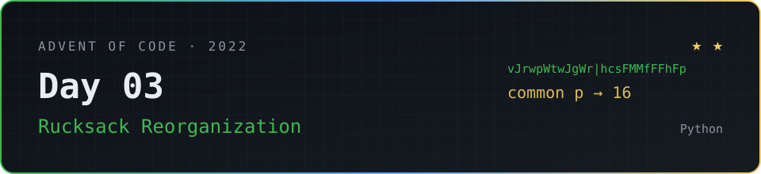
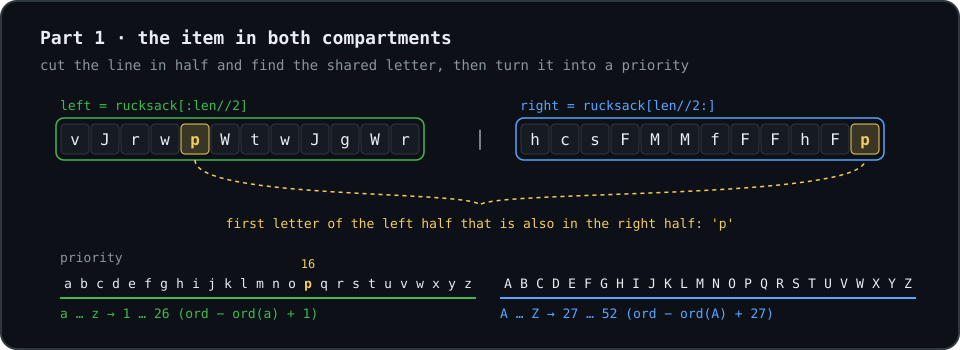
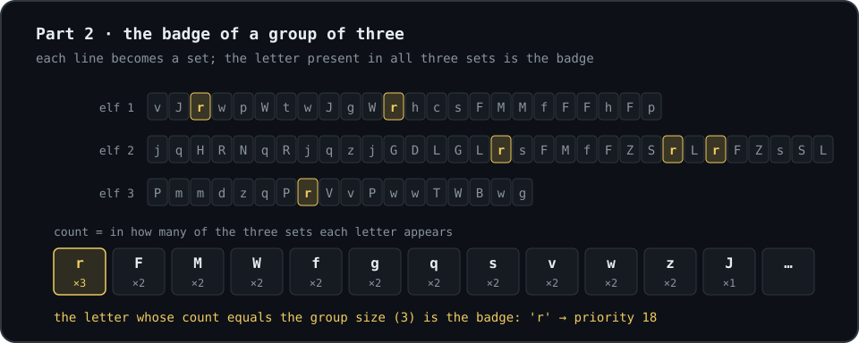

<div align="center">
  
</div>

> [!IMPORTANT]
> **The code was written 100% by a human.** Every line of the solutions in this repository was written by hand, without any kind of help from artificial intelligence: no generated code, no hints, no suggestions.
> AI was only used afterwards, to turn that finished, hand-written code into this README (the text and the diagrams).

## 🧩 The puzzle

Each line is a rucksack: a string of letters, one letter per item type. The first half of the string
is one compartment and the second half is the other. Every item type has a priority: `a`–`z` are 1–26
and `A`–`Z` are 27–52.

| Part | Question |
| :--: | -------- |
| ⭐ 1 | Each rucksack has exactly one item type in both compartments. What is the sum of their priorities? |
| ⭐ 2 | Every group of three consecutive elves shares exactly one item type, their badge. What is the sum of the badge priorities? |

## 💡 The idea

Both parts look for **the one letter that is common** to a few strings, then turn it into a priority
with a bit of ASCII arithmetic.

### Part 1 · two halves

Cut the line at `len // 2` and find the letter that appears on both sides.

<div align="center">
  
</div>

### Part 2 · groups of three

Take the lines three at a time. Turn each line into a set of letters and count in how many of those
sets every letter appears. The badge is the letter whose count equals the size of the group.

<div align="center">
  
</div>

## 🛠️ Implementations

| Language | Highlights |
| -------- | ---------- |
| [Python](./python) | Part 1 compares every letter of the left half with every letter of the right half and returns the first match. Part 2 builds one `set` per line, then a `cross_data` dictionary counting in how many sets each letter appears. `get_priority` uses `ord` offsets from `a` and `A`. |

```python
def get_priority(type):
    ot = ord(type)
    oa = ord('a')
    oz = ord('z')
    oA = ord('A')

    if ot >= oa and ot <= oz:
        return ot - oa + 1

    return ot - oA + 27
```

## ⏱️ Complexity

With `n` rucksacks of length up to `m`:

| | Time | Memory |
| - | :--: | :----: |
| Part 1 | `O(n · m²)` (letter-by-letter comparison of the halves) | `O(n · m)` |
| Part 2 | `O(n · m)` | `O(m)` per group |

## ▶️ Running

`main.py` reads `./input.txt` (set `TEST` to `True` in the code to use `./test.txt`).

```bash
cd python && python3 main.py    # Python
```
