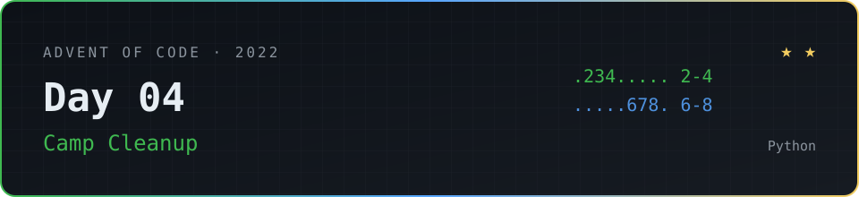
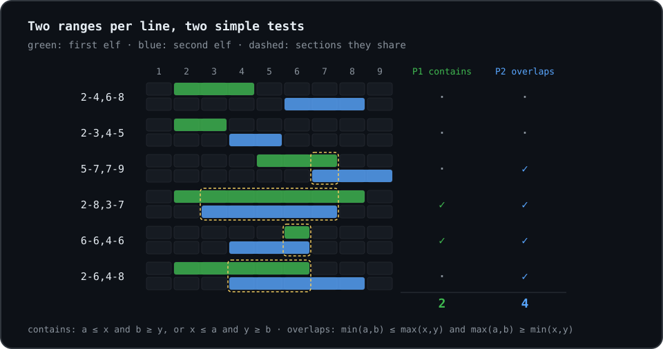

<div align="center">
  
</div>

> [!IMPORTANT]
> **The code was written 100% by a human.** Every line of the solutions in this repository was written by hand, without any kind of help from artificial intelligence: no generated code, no hints, no suggestions.
> AI was only used afterwards, to turn that finished, hand-written code into this README (the text and the diagrams).

## 🧩 The puzzle

Pairs of elves are assigned ranges of section IDs to clean. Each line holds one pair, like `2-4,6-8`:
the first elf cleans sections 2 to 4 and the second cleans 6 to 8.

| Part | Question |
| :--: | -------- |
| ⭐ 1 | In how many pairs does one range fully contain the other? |
| ⭐ 2 | In how many pairs do the ranges overlap at all? |

## 💡 The idea

Each line is just four numbers `a, b, x, y`, and each part is a constant-time test on them.

- **Fully contains**: `a ≤ x and b ≥ y` (first holds second) or `x ≤ a and y ≥ b` (second holds first).
- **Overlaps**: the ranges share a section when neither one ends before the other starts, i.e. the smaller
  end of one is not below the start of the other.

Count the `True`s and you are done.

<div align="center">
  
</div>

## 🛠️ Implementations

| Language | Highlights |
| -------- | ---------- |
| [Python](./python) | Each line is split with the regex `,\|-` into four ints. Both tests are small functions over the four numbers, and `sum()` over a list of booleans counts how many are `True`. |

```python
def does_pair_overlap_at_all(pair):
    a, b, x, y = pair

    return min(a, b) <= max(x, y) and max(a, b) >= min(x, y)
```

## ⏱️ Complexity

| | Time | Memory |
| - | :--: | :----: |
| Both parts | `O(n)` | `O(n)` (the parsed pairs) |

## ▶️ Running

`main.py` reads `./input.txt` (set `TEST` to `True` in the code to use `./test.txt`).

```bash
cd python && python3 main.py    # Python
```
